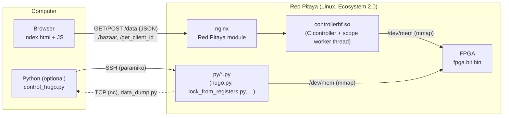
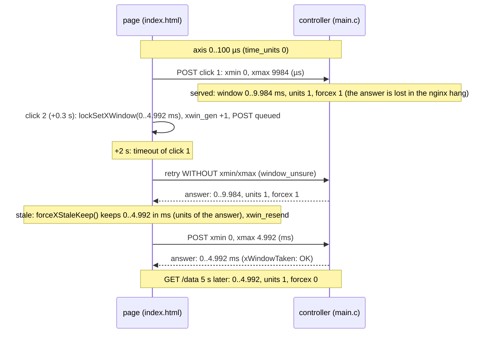
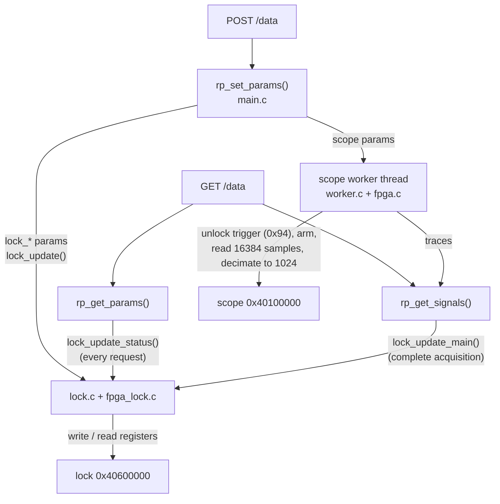
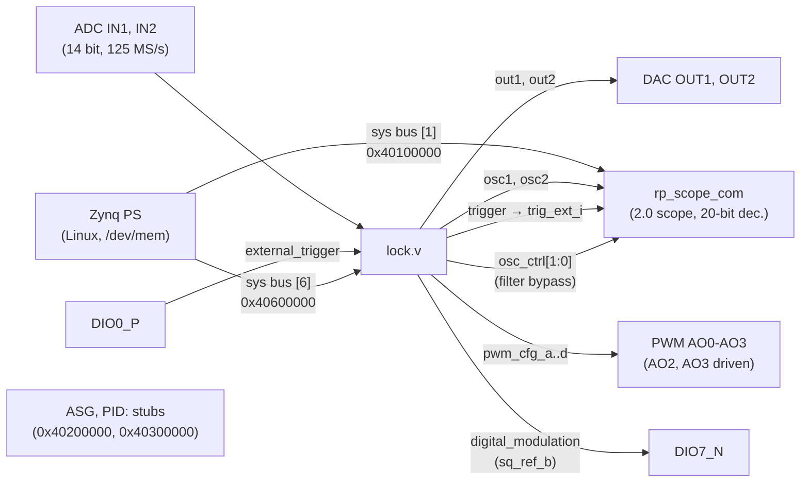
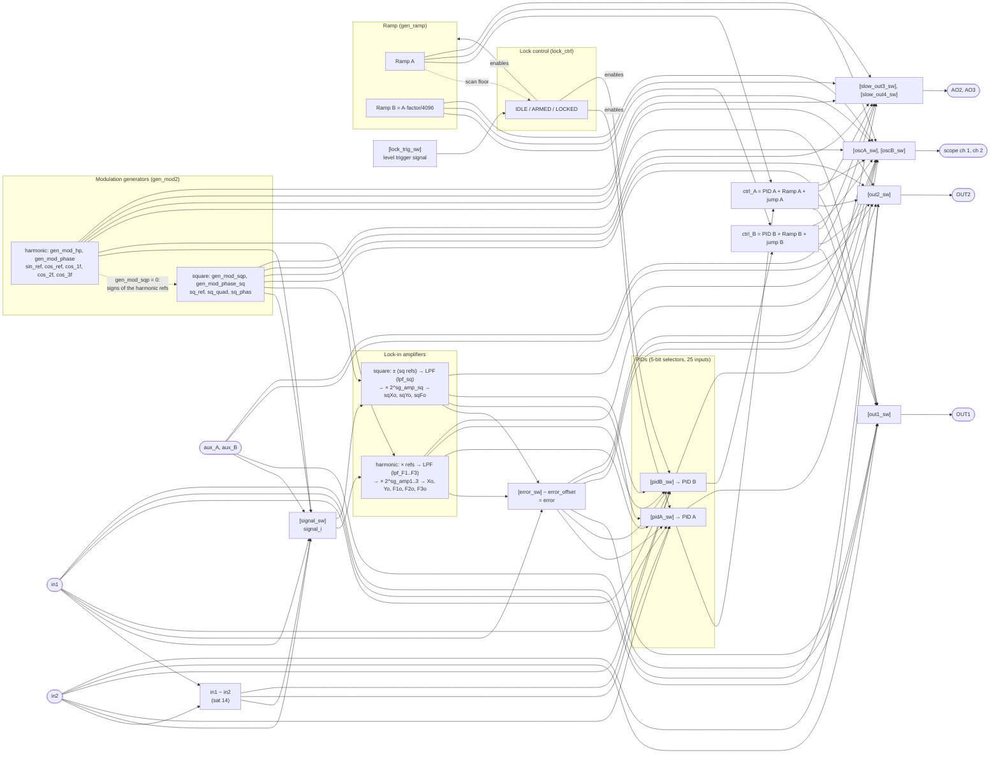
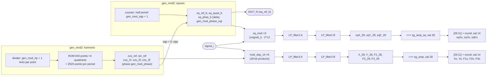
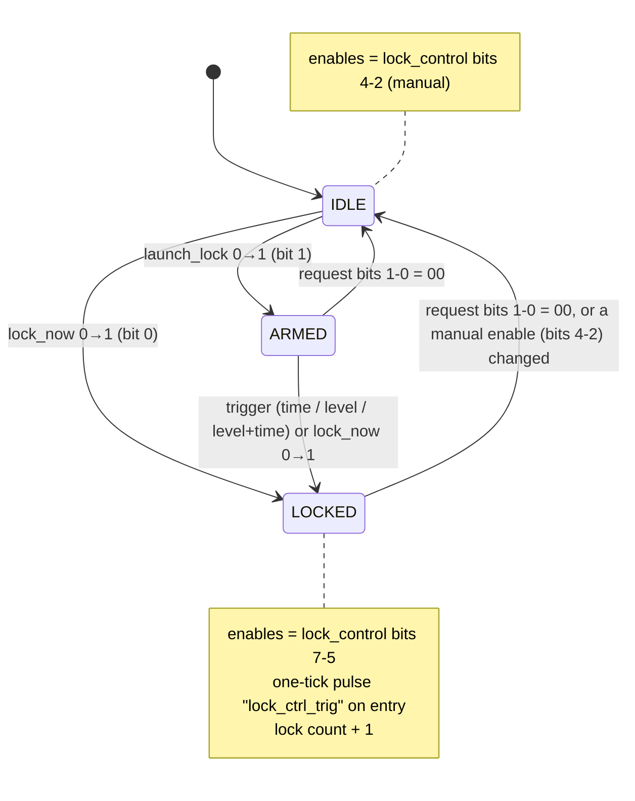
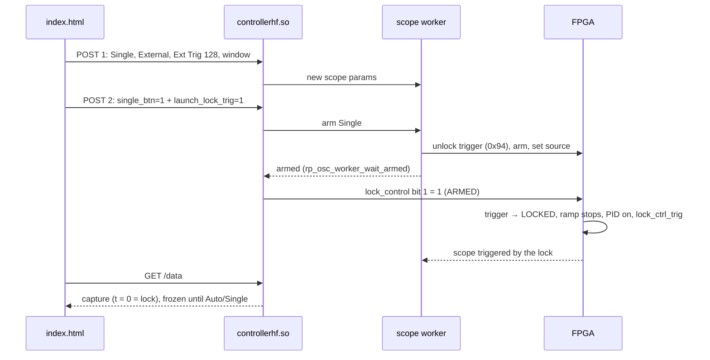
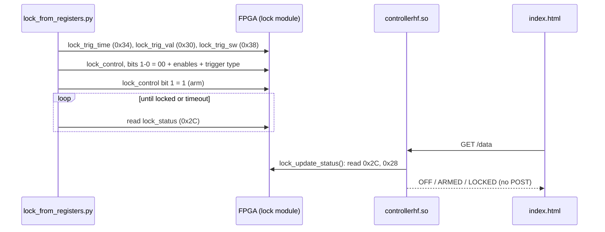

# Internal structure

How `lock_in+pid` v2.2.16 (branch `master`) is built: the three layers (web page, server, FPGA), how they talk, and how the
instruments are connected inside the FPGA. Registers: [FPGA.md](FPGA.md). Specifications: [App.md](App.md).
Source tree and build: [Devel.md](Devel.md).

- [Layers](#layers)
- [Web page ↔ server](#web-page--server)
  - [Time window of the plot and Force X](#time-window-of-the-plot-and-force-x)
- [Server ↔ FPGA: the C controller](#server--fpga-the-c-controller)
- [Inside the FPGA](#inside-the-fpga)
  - [Top level](#top-level)
  - [Signal flow of the lock module](#signal-flow-of-the-lock-module)
  - [Modulation and lock-in detail](#modulation-and-lock-in-detail)
  - [Lock control](#lock-control)
  - [Bus interface](#bus-interface)
- [Parameters, registers and `config_tool.py`](#parameters-registers-and-config_toolpy)

## Layers

As described in the [published documentation](https://marceluda.github.io/rp_lock-in_pid/TheApp/instruments/instruments_01_intro/),
the App has a client-server structure on top of a programmable circuit:

- **Client**: `index.html` (HTML + jQuery + Flot, all in one file) runs in the browser. It polls the server,
  draws the scope and sends parameter changes.
- **Server**: the nginx of the Red Pitaya Ecosystem loads `controllerhf.so` (the App controller) when the App
  is started (`/bazaar?start=lock_in+pid`); on Ecosystem 2.0 the FPGA image `fpga.bit.bin` is loaded at the
  start by `fpga.sh` (`fpgautil`). Unlike lock_in+pid_harmonic, this App adds **no HTTP endpoints of its own**:
  `nginx.conf` only serves `index.html` with `Cache-Control: no-cache`.
- **Scripts on the board** (`py/`) access the FPGA registers directly through `/dev/mem`, with or without
  the page open; `control_hugo.py` runs them from a computer through SSH ([Remote.md](Remote.md)).
- **Hardware**: the FPGA (`lock.v` and the Red Pitaya scope) does all the real-time processing. The software
  only reads and writes registers.

## Web page ↔ server

| Endpoint | Method | Who | What |
|---|---|---|---|
| `/bazaar?start=lock_in+pid` / `?stop=` | GET | page at start / Restart | start the App (controller + FPGA) / stop the loaded App |
| `/data` | GET | page, polling | parameters (JSON `datasets.params`) and the two scope traces (`datasets.signals`, 1024 points) |
| `/data` | POST | page, on each change | changed parameters only, in chunks of at most 600 bytes, with retries (Ecosystem 2.0 hangs with large bodies; `CHANGELOG.md` 0.2.3) |
| `/get_client_id`, `/set_client_id` | GET/POST | page | claim the board like the factory Apps; detect another client |

The page keeps the parameters received from the server (`params.orig`), the edited ones (`params.local`) and
the unsent changes, and sends only what changed. Read-only values (lock-in outputs, `lock_lock_status`,
`lock_lock_control`, `meas_*`, monitor) are never sent. The state of the page is saved per tab
(`sessionStorage`) and restored after a Restart; configs are saved in `localStorage` (key
`lockConfig_lock_in+pid`). A Config → load sends the whole config except the time-scale values derived by the
server (`forcex_flag`, `time_units`, `time_range`, `gui_xmin`, `gui_xmax`) and applies the time window in the
units of the config (v2.2.6). On Ecosystem 2.0 the page also checks with `/get_client_id` that the board is
answering and that the App is loaded before polling `/data` ("cautious mode", v0.2.4); every `POST /data` leaves
an open connection in the nginx of the board (see [Remote.md](Remote.md#the-post-data-interface-of-the-ecosystem)).

Ramp Controller (v2.2.16, page only, ported from `lock_in+pid_plus` 2.2.0 through `lock_in+pid_harmonic` 2.3.31): the
tabs *period* / *freq* and *Lock osc. screen* are the `[RAMP CALC]` (pure functions: period, frequency, f → step,
amplitude / offset ↔ limits, zoom → limits; also run by `test/ramp_ui_sim.js`) and `[RAMP UI]` blocks of `index.html`
(l. 3415-3641 and 3643-3953; the period of the ramp, `rampPeriodCycles()`, is in `[TRIG FROM GRAPH]`, l. 3204-3209, and
the windows of *Reset zoom* / *Lock osc. screen*, `resetZoomWindow()` and the whole / half cycle `resetZoomCycleNext()`,
in `[RESET ZOOM]`, l. 3289-3413). They only write the existing parameters `lock_ramp_step`, `lock_ramp_low_lim`,
`lock_ramp_hig_lim` (one POST) and, for *Lock osc. screen*, the scope parameters `trig_source`, `trig_mode`,
`lock_trig_sw` and the time window (`xmin` / `xmax`), as *Reset zoom* does. Their state (active tab in `localStorage`
key `lockin_ramp_tab_lock_in+pid`, l. 3652; `ramp_ls`, `ramp_f_nominal`) is not part of the parameters nor of the
configs. The code is the same as in the other lock-in Apps: this App has no `lock_ramp_sawtooth` parameter, so the
generic expressions `Number(p.lock_ramp_sawtooth)` give 0 (triangle) and the handlers of `#lock_ramp_sawtooth` find no
element (`devAgent.md` 2026-11-13 14:50). No change in the controller nor in the FPGA ([Usage.md](Usage.md#ramp-controller)).
The *Ramp period* field is a text field whose parser is in `input_unit_parsers` (l. 2489-2491, `rampStepParseField()`
→ `rampParseStep()`), like the *Time trigger* / *Level trigger* fields.

### Time window of the plot and Force X

The time window of the scope is a pair of parameters, `xmin` / `xmax`, in the **time units** of the server
(`time_units`: 0 µs, 1 ms, 2 s), which follow the decimation (`time_range`) that the controller chooses for the window
(`transform_acq_params()`, `src/main.c` l. 583-764). `time_units` is read-only for the page (`src/main.c` l. 80:
`rp_set_params()` ignores it), so **`xmin` / `xmax` of a POST are always read in the current units of the server**.
When a POST changes the units (e.g. a window of 0 … 2 s followed by a *Reset zoom* to 0 … 9.984 ms), the controller
converts the window to the new units and raises **`forcex_flag`** (`src/main.c` l. 97-102, set at l. 727-737, with the
time of `forcex_mark()`): the page must put its X axis on the `xmin` / `xmax` of the server. The flag stays 1 in the
answer of that POST **and in every `GET /data`** until the page sends the next POST: one that only sends the window
back (`rp_set_params()`, l. 923-926), or a scope change whose window is within a factor 33 of the forced one
(`ratio > 0.03`) or comes more than 1.5 s after it (`FORCEX_STALE_MS`, l. 477; l. 627-630). While `forcex_state` is 1
the server answers its forced window and units to a POST with another window (l. 676-688).

Up to v2.2.15 the page applied the forceX of every GET and of every POST answer. Two problems, both fixed in v2.2.16
in the `[FORCEX]` block of `index.html` (l. 316-449) and in `sendParams()` / `postParamsChunks()`:

1. **A stale forceX of a `GET /data`** (from `lock_in+pid_plus` 2.2.0-rc4). A GET that was in flight when the page set
   a new window (the second click of *Reset zoom*, 0 … T/2) brought ~70 ms later the window of the first click; and
   the repeated flag undid a wheel / box zoom made from t = 0 during the 250 ms before its POST.
2. **A POST that timed out and was retried** (from `lock_in+pid_plus` 2.2.1, two rounds; bug found by testAgent on
   this App: `reportes/lock-in_pid/2026-11-13_1806_v2216.md`, Force X 19/21). The nginx of Ecosystem 2.0 hangs ~2 s
   every ~3 min. If the POST of the first click of *Reset zoom* fell in a hang it got no answer in
   `post_chunk_timeout` (2 s, l. 132) and was sent again with the same body, while the second click (0 … T/2) waited
   in `send_que`. The answer of the retry (`forcex_flag` 1, 0 … T) put the axis back to 0 … T and the queued POST sent
   0 … T again. Worse, when nginx did serve the timed-out POST and only its answer was lost (the realistic case, hook
   `__serve = true`), the retry with the same body (0 … 9984 in µs) was read in the **new** units (ms) and sent the
   server to s; the window sent next by the page was then ignored, because the new forceX was less than 1.5 s old
   (`reportes/lock-in_pid/2026-11-13_1848_forcex_retry.md`: 0/6).

The pieces (lines of `index.html` v2.2.16):

| Piece | Where | What it does |
|---|---|---|
| `xwin_gen` / `xWindowLocal()` | l. 359, 392-398 | counter of "the page touched the X window": +1 in `lockSetXWindow()` (l. 4032-4033, used by Reset zoom, Lock osc. screen, Capture Lock), `xWindowToParams()` (l. 5086-5087), X± (l. 643), the X offset buttons (l. 710), the X zoom of the wheel (l. 5135). `xWindowLocal()` also sets `xwin_pending` and cancels a pending resend |
| `xWindowGen()` | l. 390; at the start (l. 5961) and at the answer (l. 6022) of every POST | +1 without a window of the page |
| `get_xgen` | l. 4784 | value of `xwin_gen` when a `GET /data` starts (as `get_epoch` = `plot_epoch` for the data, v2.2.9) |
| `getForceXApply(p, get_epoch, get_xgen)` | l. 429-437, used at l. 4868 | the forceX of a GET answer is applied only if `forcex_flag` = 1, the GET started after the last Reset zoom was answered (`get_epoch === plot_epoch`), nothing touched the X window nor sent / got a POST since the GET started (`get_xgen === xwin_gen`), no window of the page is waiting to be sent (`xwin_pending`), and its window (`xmin`, `xmax`, `time_units`: `forceXKey()`, l. 399) is not the one of the last forceX applied (`forcex_last`) |
| `forceXUnitsKeep(p, applied)` | l. 442-448, used at l. 4869 | a GET whose forceX is not applied never changes the time units of the page (also with `forcex_flag` 0: the server may have ended the forceX while the page still has its window in the old units); the forceX of a GET is put on the axis before `loadParams()` (l. 4870-4875) |
| `xgen_post` | l. 5962 | `xwin_gen` when the POST leaves; at the answer `xwin_gen !== xgen_post` means that the page set the X window during the POST (`xwin_stale`, l. 6009) |
| retry without the window | `postParamsChunks(.., post_info)`, l. 5859-5910 (the retry at l. 5888-5899) | a chunk that timed out is sent again (up to `post_chunk_retries` = 2, l. 133) **without `xmin` / `xmax`** (all the other values are absolute; a chunk left empty carries `auto_flag` 0, a no-op), and `post_info.window_unsure` marks the answer as stale |
| `xsent_s` / `xWindowTaken()` | l. 5993-5995; l. 371-383 | every POST that sends a window (not AUTO, not the send_all of a Config load) keeps it in seconds and checks that the answer has it (tolerance $10^{-4}$ of its width) |
| `forceXStaleKeep(srv, at)` | l. 403-427, used at l. 6048 | for a stale answer (the page set the window during the POST, the retry went without it, or a resend is pending), the window of the answer is not applied (nor its forceX): the window of the axis is kept, converted to the units of the answer (the server is already in them), `forcex_last` is set so that the GETs repeating the flag do not apply it, and `xwin_resend` makes a later POST send it |
| resend after `forcex_hold_ms` | l. 363-367, 6010-6021, 6102-6110 | an answer with `forcex_flag` 1 and another window (the server kept its forced one) is stale too: the page sends its window again after `forcex_hold_ms` = 1.7 s (> `FORCEX_STALE_MS`), with `xwin_resend_timer`, up to `xwin_resend_max` = 3 times in a row (then it takes the window of the server). Until then POSTs for other changes go without `xmin` / `xmax` (l. 5980-5991) and their answers do not set the window either. AUTO cancels a pending resend (l. 5980) |
| `post_sent` | l. 389; set at l. 6000, used by `unsentChanges()` (l. 5365) and `loadParams()` (l. 5739-5743) | the parameters of the POST in flight: a GET answered meanwhile (it may carry the old server values) does not replace them in `params.local`, so a value changed back to the previous one during the wait is still an unsent change (it was lost: 3 of 12 runs in the simulation with v2.2.15) |

`plot_epoch` alone (v2.2.9) was not enough: it moves only with Reset zoom and Lock osc. screen, not with the box, the
wheel or X±. A forceX that is not stale (e.g. another client sets 0 … 2 s and the units change) still reaches the page,
once. No change in the controller.

The second click of *Reset zoom* while the POST of the first one is retried, with the timed-out POST served by the
server (the case of the second round):

Before the second round the retry carried `xmax` 9984, which the server, already in ms, read as 9984 ms and went to
s. Checked by `test/forcex_race_sim.js` (19/19: its server model follows `src/main.c`, with `forcex_state`, the ratio
0.03, `FORCEX_STALE_MS` and float32 windows; cases 5 to 7 are the retried POSTs; with `--old` on the first round 6b,
6c and 7b fail) and on RP2 (`reportes/lock-in_pid/2026-11-13_2312_forcex_retry2.md`): with the hook `__serve = true`
21/21 (from µs and from s, second click at 0.3 / 1 / 1.9 s), `__hold = 2` 3/3, `__serve = false` 3/3, a zoom right
after a change of units sent again ~1.7 s later 3/3, and 20/20 quick second clicks without hook. The console shows
`postParamsChunks: chunk 1/1 timed out, retrying (1/2)` and `sendParams: X window of the page not on the server: its
answer (…) not applied, 0 .. 4.992 sent again`.

## Server ↔ FPGA: the C controller

`src/` builds `controllerhf.so`, the standard interface of a Red Pitaya App (`rp_app_init`, `rp_app_exit`,
`rp_set_params`, `rp_get_params`, `rp_get_signals`):

- **Parameter table**: `src/main.c` `rp_main_params[]` (225 parameters, `PARAMS_NUM`, indices in `src/main.h`):
  the scope (0-41), the AWG and PID of the original scope App (42-80, unused by this FPGA), the lock module
  (81-220, `[MAINDEFH DOCK]`) and, since v2.2.9, four read-only scope state parameters (221-224: `scope_gen`,
  `scope_acq_state`, `scope_acq_gen`, `sig_gen`; `src/main.h` l. 291-294) that tell the page which acquisition a
  trace comes from. Most `lock_*` parameters map one to one to a register; some are fields of a
  register (`lock_lpf_F1_tau`/`_order` → `lpf_F1`; `lock_ctrl_aux_*` → `lock_control`; `lock_osc1/2_filt_off` →
  `osc_ctrl`; `lock_pidA_irst/freeze/ifreeze` → `pidA_ctrl`; `lock_rl_*_enable`, `lock_rl_reset` → `rl_config`;
  `lock_sf_*` → `sf_config`). `lock_osc_raw_mode` and `lock_osc_lockin_mode` are options of the scope worker
  (Raw mode, R|Phase mode); `lock_mod_sq_on` and `lock_mod_harmonic_on` are not written to any register. Values
  outside the `min`/`max` of the table are clamped by `rp_set_params()` (`src/main.c` l. 906-914).
- **`lock_update()`** (`src/lock.c` l. 222-366) writes all the lock registers from the parameters each time a
  lock parameter changes; `lock_control` only when the value composed from `lock_ctrl_aux_*` changes (v2.2.6).
- **`lock_update_main()`** (l. 395-535) reads every lock register back into the parameters, but only when
  `rp_get_signals()` gets a complete acquisition (`src/main.c` l. 1273). `X_28`..`sqF_28` and `cnt_clk*` are
  read between `lock_freeze_regs()` / `lock_restore_regs()` (freeze with `read_ctrl[0]`).
- **`lock_update_status()`** (l. 433-465) copies `lock_status` and `lock_control` to the parameters on **every**
  `rp_get_params()` (`src/main.c` l. 1206), so the page sees the lock state also when the scope gets no
  triggers (the ramp stops when the lock closes). If `lock_control` was written from outside (Python), its bits
  are copied to the `lock_ctrl_aux_*` parameters. Nothing is written to the FPGA there.
- **Scope worker** (`src/worker.c`): a thread that arms the scope, waits for the trigger (on 2.0 it unlocks the
  trigger at 0x94 before each acquisition and detects the end with `conf` bit 4), reads both buffers and
  decimates them to 1024 points; it also runs the auto-set (AUTO) and the measurements. A POST without scope
  changes does not reset it. Since v2.2.9 (port of lock_in+pid_harmonic v2.3.23) every point is a sample counted
  from the trigger and is read only if it was written in the current acquisition (windows ≥ 1.5 s are read while
  being written, and partial traces are served); and a lock request that arms a Single no longer waits in the
  POST: the request bits are held out of `lock_control` (`lock_request_hold()` and the `lock_ctrl_hold*` state,
  `src/lock.c` l. 76-81 and 620) until the worker has enabled the trigger of that acquisition, which keeps
  *Capture Lock* deterministic also with slow scans ([`lock_capture.md`](../lock_in+pid/doc/lock_capture.md),
  section "v2.2.9 (lock_in+pid_harmonic v2.3.23): slow scans").

## Inside the FPGA

### Top level

`fpga/prj/v0.94/rtl/red_pitaya_top.sv` (RedPitaya-FPGA v0.94 adapted to behave like the 2015.2 design of the App):

The DACs are driven only by the lock module and the scope only sees the two signals chosen inside it
(`oscA_sw`, `oscB_sw`), never the raw ADC.

### Signal flow of the lock module

`fpga/prj/v0.94/rtl/lock.v` and `lock/*.v`. Selectors are drawn as `[sel]` with the register name; their
values are in [FPGA.md](FPGA.md#selector-values). This is the "instruments" view of the published
documentation applied to v2.2.6.

Main points (lines of `lock.v`):

- **Control signals** (l. 250-259): `ctrl_A = pidA_out + ramp_A + jumpA`, `ctrl_B = pidB_out + ramp_B + jumpB`,
  saturated to 14 bits.
- **Scope** (l. 268-317): two 32-input registered selectors (30 signals used); external trigger from `trig_sw`
  (l. 327-347).
- **Outputs** (l. 352-398): any of 16 signals, **without** added modulation. Slow outputs 3 and 4 (l. 445-567):
  registered selectors, mapped to 0..1.8 V by `(x + 8192)·156/1024`; slow outputs 1 and 2 are not driven.
- **Error** (l. 620-654): one of 0, in1, Xo, F1o, F3o, sqXo, sqYo, sqFo minus `error_offset`; its mean and square
  are accumulated over $2^{27}$ ticks for the Monitor.
- **PIDs** (l. 1195-1297): each PID takes a signal (`pidX_sw`, `muxer5`), computes P, I, D (`lock_pid_block.v`); its
  output is forced to 0 (and the integrator reset) when the lock control disables it.

### Modulation and lock-in detail

The A and B stages of each filter are bypassed according to bits `[5:4]` of the filter register (order 0/1/2,
[FPGA.md](FPGA.md#lpf_f1-lpf_f2-lpf_f3-lpf_sq-0x074-0x080)). The bypass is combinational, which makes the path
from the reference ROM to the PIDs, the scope and the lock trigger long (the timing that does not close, see
[App.md](App.md#general-data)).

### Lock control

The state machine of `lock/lock_ctrl.v`, configured and commanded by `lock_control` (0x028) and observed in
`lock_status` (0x02C). Full description: [`lock_control.md`](../lock_in+pid/doc/lock_control.md).

The time trigger counts ticks from the last scan floor of the ramp; the level trigger watches the signal
selected by `lock_trig_sw` (one clock later than in lock_in+pid_harmonic, because the comparisons are
registered in this App). On entering LOCKED the FPGA emits `lock_ctrl_trig`, bit 7 of `trig_sw` ("Lock
control trig"): the web page arms a Single acquisition on it to capture the lock.

A lock request from the page with *Capture Lock*:

And from Python on the board (`py/lock_from_registers.py`), with or without the page:

**Fixed in v2.2.7** (seen by testAgent in v2.2.6, `testAgent.md` 2026-10-10 09:48, `reportes/lock-in_pid.md`):
the trigger values written by Python (0x30, 0x34, 0x38) did not appear in the Time / Level fields of the page,
and the next change of a lock parameter made from the page rewrote 0x34 with the copy of the controller (the
lock then fired at another time). Since v2.2.7 the C writes each of them only when its parameter changes and
copies a value written from outside to the parameter (CHANGELOG 2.2.7). Before: `lock_update_status()` only copies `lock_control`; `lock_update_main()` does
read 0x30/0x34/0x38 back, but only with complete acquisitions (which stop when the ramp stops in Normal mode),
and `lock_update()` rewrites every lock register on any lock change.

### Bus interface

`[FPGA MEMORY DOCK]` of `lock.v` (l. 1304-1628), generated by `resources/config_tool.py`: registers written by
the PS and the read multiplexer. Since v2.2.5 `sys_rdata` is loaded only during a read and then held, and the
read-only signals are read from registered copies (`*_rd`, l. 966-1006, and the `*_reg` copies of `read_ctrl[0]`)
that are held during the read, with a 2-cycle multicycle constraint (`prj/v0.94/sdc/red_pitaya.xdc` l. 76-83).
The copies are not used by the real-time loop. Details: [FPGA.md](FPGA.md#lock-module-0x40600000).

## Parameters, registers and `config_tool.py`

The same register list exists in several places: `lock.v` (registers and bus decoder), `src/fpga_lock.h`
(C struct), `src/fpga_lock.c` / `src/lock.c` (writes/reads), `src/main.c` / `main.h` (parameters), `index.html`
(fields and selectors) and `py/hugo.py`. `resources/config_tool.py` holds the table and regenerates the blocks
marked by "docks" in those files (`// [WIREREG DOCK]`, `// [FPGA MEMORY DOCK]`, `[FPGAUPDATE DOCK]`,
`[PARAMSUPDATE DOCK]`, `[MAINDEFH DOCK]`, `# [REGSET DOCK]`, …). See [Devel.md](Devel.md#registers-and-config_toolpy).
