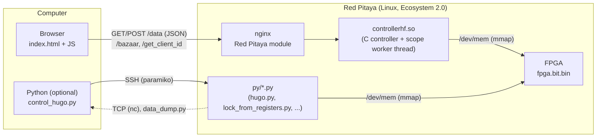
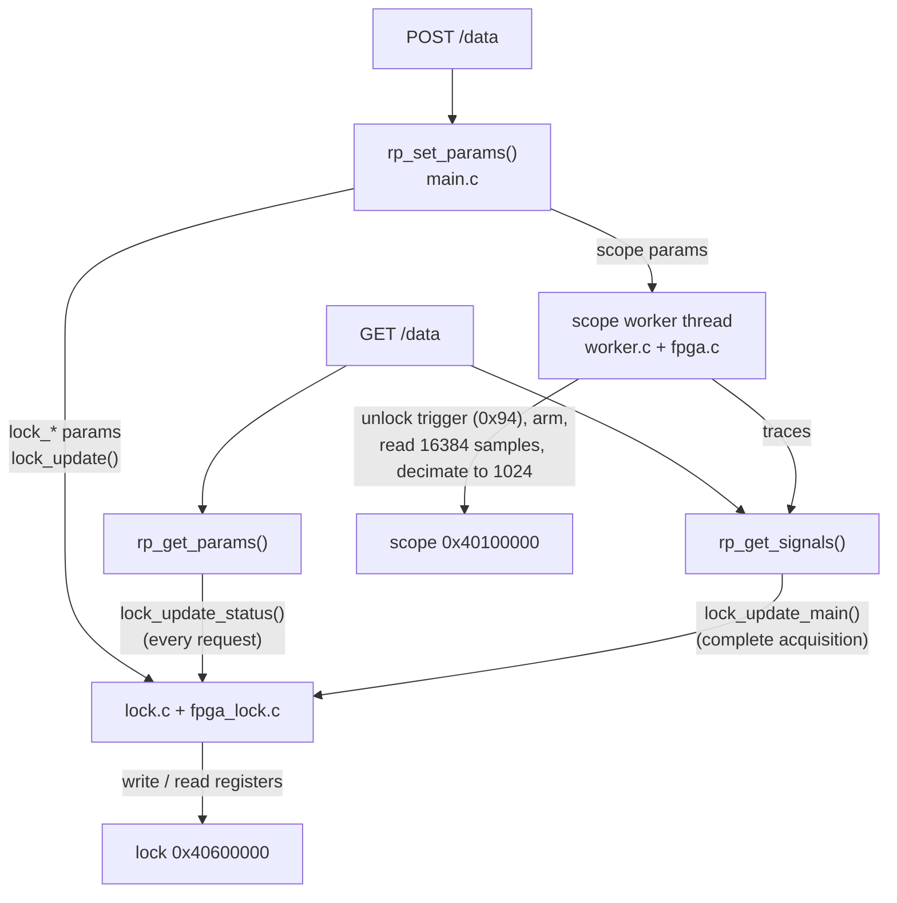
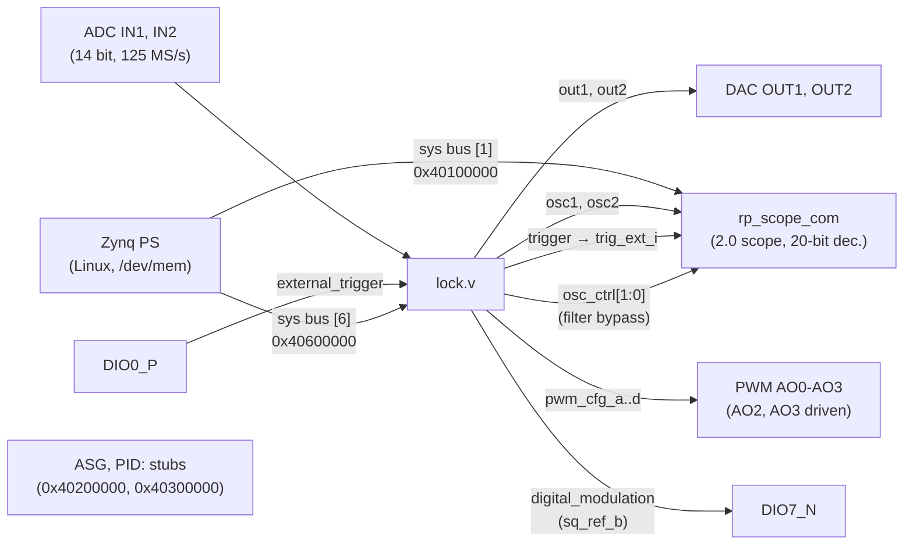
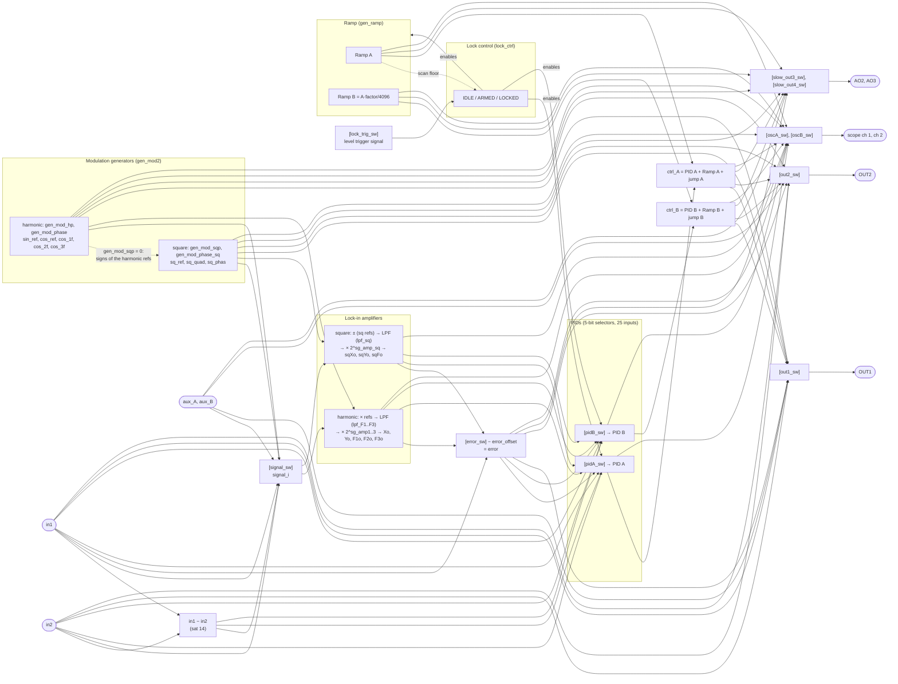
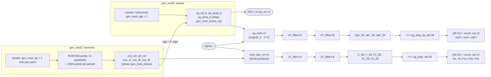
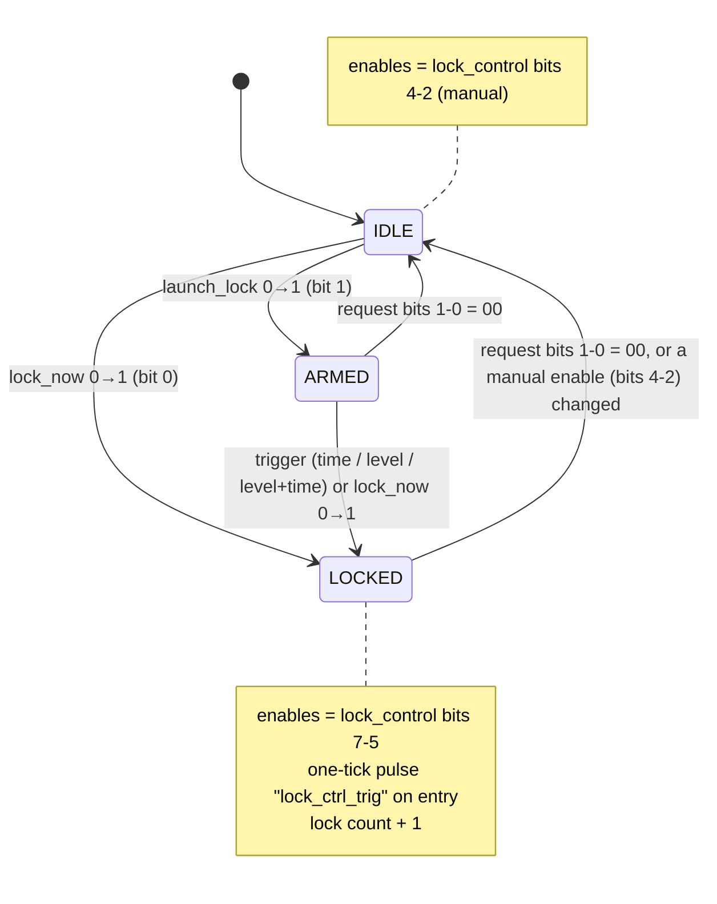
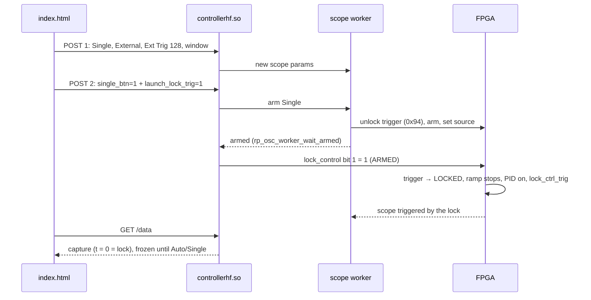
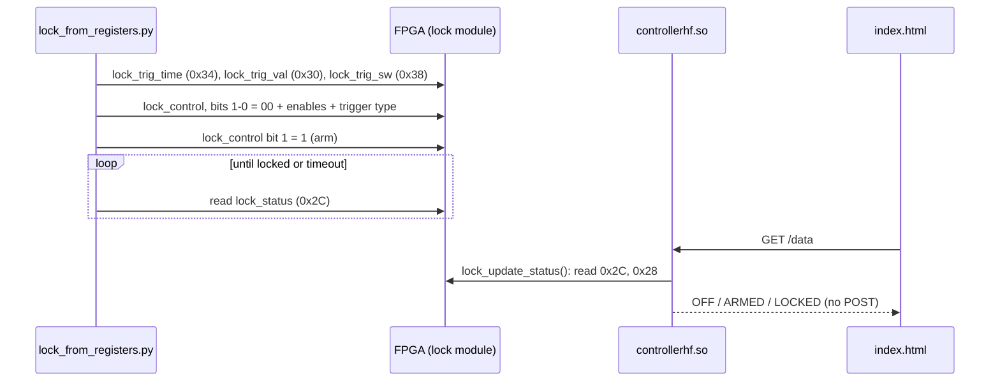

# Internal structure

How `lock_in+pid` v2.2.10 (branch `master`) is built: the three layers (web page, server, FPGA), how they talk, and how the
instruments are connected inside the FPGA. Registers: [FPGA.md](FPGA.md). Specifications: [App.md](App.md).
Source tree and build: [Devel.md](Devel.md).

- [Layers](#layers)
- [Web page ↔ server](#web-page--server)
- [Server ↔ FPGA: the C controller](#server--fpga-the-c-controller)
- [Inside the FPGA](#inside-the-fpga)
  - [Top level](#top-level)
  - [Signal flow of the lock module](#signal-flow-of-the-lock-module)
  - [Modulation and lock-in detail](#modulation-and-lock-in-detail)
  - [Lock control](#lock-control)
  - [Bus interface](#bus-interface)
- [Parameters, registers and `config_tool.py`](#parameters-registers-and-config_toolpy)

## Layers

As described in the [published documentation](https://marceluda.github.io/rp_lock-in_pid/TheApp/instruments/instruments_01_intro/),
the App has a client-server structure on top of a programmable circuit:

- **Client**: `index.html` (HTML + jQuery + Flot, all in one file) runs in the browser. It polls the server,
  draws the scope and sends parameter changes.
- **Server**: the nginx of the Red Pitaya Ecosystem loads `controllerhf.so` (the App controller) when the App
  is started (`/bazaar?start=lock_in+pid`); on Ecosystem 2.0 the FPGA image `fpga.bit.bin` is loaded at the
  start by `fpga.sh` (`fpgautil`). Unlike lock_in+pid_harmonic, this App adds **no HTTP endpoints of its own**:
  `nginx.conf` only serves `index.html` with `Cache-Control: no-cache`.
- **Scripts on the board** (`py/`) access the FPGA registers directly through `/dev/mem`, with or without
  the page open; `control_hugo.py` runs them from a computer through SSH ([Remote.md](Remote.md)).
- **Hardware**: the FPGA (`lock.v` and the Red Pitaya scope) does all the real-time processing. The software
  only reads and writes registers.

## Web page ↔ server

| Endpoint | Method | Who | What |
|---|---|---|---|
| `/bazaar?start=lock_in+pid` / `?stop=` | GET | page at start / Restart | start the App (controller + FPGA) / stop the loaded App |
| `/data` | GET | page, polling | parameters (JSON `datasets.params`) and the two scope traces (`datasets.signals`, 1024 points) |
| `/data` | POST | page, on each change | changed parameters only, in chunks of at most 600 bytes, with retries (Ecosystem 2.0 hangs with large bodies; `CHANGELOG.md` 0.2.3) |
| `/get_client_id`, `/set_client_id` | GET/POST | page | claim the board like the factory Apps; detect another client |

The page keeps the parameters received from the server (`params.orig`), the edited ones (`params.local`) and
the unsent changes, and sends only what changed. Read-only values (lock-in outputs, `lock_lock_status`,
`lock_lock_control`, `meas_*`, monitor) are never sent. The state of the page is saved per tab
(`sessionStorage`) and restored after a Restart; configs are saved in `localStorage` (key
`lockConfig_lock_in+pid`). A Config → load sends the whole config except the time-scale values derived by the
server (`forcex_flag`, `time_units`, `time_range`, `gui_xmin`, `gui_xmax`) and applies the time window in the
units of the config (v2.2.6). On Ecosystem 2.0 the page also checks with `/get_client_id` that the board is
answering and that the App is loaded before polling `/data` ("cautious mode", v0.2.4); every `POST /data` leaves
an open connection in the nginx of the board (see [Remote.md](Remote.md#the-post-data-interface-of-the-ecosystem)).

## Server ↔ FPGA: the C controller

`src/` builds `controllerhf.so`, the standard interface of a Red Pitaya App (`rp_app_init`, `rp_app_exit`,
`rp_set_params`, `rp_get_params`, `rp_get_signals`):

- **Parameter table**: `src/main.c` `rp_main_params[]` (225 parameters, `PARAMS_NUM`, indices in `src/main.h`):
  the scope (0-41), the AWG and PID of the original scope App (42-80, unused by this FPGA), the lock module
  (81-220, `[MAINDEFH DOCK]`) and, since v2.2.9, four read-only scope state parameters (221-224: `scope_gen`,
  `scope_acq_state`, `scope_acq_gen`, `sig_gen`; `src/main.h` l. 291-294) that tell the page which acquisition a
  trace comes from. Most `lock_*` parameters map one to one to a register; some are fields of a
  register (`lock_lpf_F1_tau`/`_order` → `lpf_F1`; `lock_ctrl_aux_*` → `lock_control`; `lock_osc1/2_filt_off` →
  `osc_ctrl`; `lock_pidA_irst/freeze/ifreeze` → `pidA_ctrl`; `lock_rl_*_enable`, `lock_rl_reset` → `rl_config`;
  `lock_sf_*` → `sf_config`). `lock_osc_raw_mode` and `lock_osc_lockin_mode` are options of the scope worker
  (Raw mode, R|Phase mode); `lock_mod_sq_on` and `lock_mod_harmonic_on` are not written to any register. Values
  outside the `min`/`max` of the table are clamped by `rp_set_params()` (`src/main.c` l. 902-908).
- **`lock_update()`** (`src/lock.c` l. 222-366) writes all the lock registers from the parameters each time a
  lock parameter changes; `lock_control` only when the value composed from `lock_ctrl_aux_*` changes (v2.2.6).
- **`lock_update_main()`** (l. 395-535) reads every lock register back into the parameters, but only when
  `rp_get_signals()` gets a complete acquisition (`src/main.c` l. 1269). `X_28`..`sqF_28` and `cnt_clk*` are
  read between `lock_freeze_regs()` / `lock_restore_regs()` (freeze with `read_ctrl[0]`).
- **`lock_update_status()`** (l. 433-465) copies `lock_status` and `lock_control` to the parameters on **every**
  `rp_get_params()` (`src/main.c` l. 1202), so the page sees the lock state also when the scope gets no
  triggers (the ramp stops when the lock closes). If `lock_control` was written from outside (Python), its bits
  are copied to the `lock_ctrl_aux_*` parameters. Nothing is written to the FPGA there.
- **Scope worker** (`src/worker.c`): a thread that arms the scope, waits for the trigger (on 2.0 it unlocks the
  trigger at 0x94 before each acquisition and detects the end with `conf` bit 4), reads both buffers and
  decimates them to 1024 points; it also runs the auto-set (AUTO) and the measurements. A POST without scope
  changes does not reset it. Since v2.2.9 (port of lock_in+pid_harmonic v2.3.23) every point is a sample counted
  from the trigger and is read only if it was written in the current acquisition (windows ≥ 1.5 s are read while
  being written, and partial traces are served); and a lock request that arms a Single no longer waits in the
  POST: the request bits are held out of `lock_control` (`lock_request_hold()` and the `lock_ctrl_hold*` state,
  `src/lock.c` l. 76-81 and 620) until the worker has enabled the trigger of that acquisition, which keeps
  *Capture Lock* deterministic also with slow scans ([`lock_capture.md`](../lock_in+pid/doc/lock_capture.md),
  section "v2.2.9 (lock_in+pid_harmonic v2.3.23): slow scans").

## Inside the FPGA

### Top level

`fpga/prj/v0.94/rtl/red_pitaya_top.sv` (RedPitaya-FPGA v0.94 adapted to behave like the 2015.2 design of the App):

The DACs are driven only by the lock module and the scope only sees the two signals chosen inside it
(`oscA_sw`, `oscB_sw`), never the raw ADC.

### Signal flow of the lock module

`fpga/prj/v0.94/rtl/lock.v` and `lock/*.v`. Selectors are drawn as `[sel]` with the register name; their
values are in [FPGA.md](FPGA.md#selector-values). This is the "instruments" view of the published
documentation applied to v2.2.6.

Main points (lines of `lock.v`):

- **Control signals** (l. 250-259): `ctrl_A = pidA_out + ramp_A + jumpA`, `ctrl_B = pidB_out + ramp_B + jumpB`,
  saturated to 14 bits.
- **Scope** (l. 268-317): two 32-input registered selectors (30 signals used); external trigger from `trig_sw`
  (l. 327-347).
- **Outputs** (l. 352-398): any of 16 signals, **without** added modulation. Slow outputs 3 and 4 (l. 445-567):
  registered selectors, mapped to 0..1.8 V by `(x + 8192)·156/1024`; slow outputs 1 and 2 are not driven.
- **Error** (l. 620-654): one of 0, in1, Xo, F1o, F3o, sqXo, sqYo, sqFo minus `error_offset`; its mean and square
  are accumulated over 2²⁷ ticks for the Monitor.
- **PIDs** (l. 1195-1297): each PID takes a signal (`pidX_sw`, `muxer5`), computes P, I, D (`lock_pid_block.v`); its
  output is forced to 0 (and the integrator reset) when the lock control disables it.

### Modulation and lock-in detail

The A and B stages of each filter are bypassed according to bits `[5:4]` of the filter register (order 0/1/2,
[FPGA.md](FPGA.md#lpf_f1-lpf_f2-lpf_f3-lpf_sq-0x074-0x080)). The bypass is combinational, which makes the path
from the reference ROM to the PIDs, the scope and the lock trigger long (the timing that does not close, see
[App.md](App.md#general-data)).

### Lock control

The state machine of `lock/lock_ctrl.v`, configured and commanded by `lock_control` (0x028) and observed in
`lock_status` (0x02C). Full description: [`lock_control.md`](../lock_in+pid/doc/lock_control.md).

The time trigger counts ticks from the last scan floor of the ramp; the level trigger watches the signal
selected by `lock_trig_sw` (one clock later than in lock_in+pid_harmonic, because the comparisons are
registered in this App). On entering LOCKED the FPGA emits `lock_ctrl_trig`, bit 7 of `trig_sw` ("Lock
control trig"): the web page arms a Single acquisition on it to capture the lock.

A lock request from the page with *Capture Lock*:

And from Python on the board (`py/lock_from_registers.py`), with or without the page:

**Fixed in v2.2.7** (seen by testAgent in v2.2.6, `testAgent.md` 2026-10-10 09:48, `reportes/lock-in_pid.md`):
the trigger values written by Python (0x30, 0x34, 0x38) did not appear in the Time / Level fields of the page,
and the next change of a lock parameter made from the page rewrote 0x34 with the copy of the controller (the
lock then fired at another time). Since v2.2.7 the C writes each of them only when its parameter changes and
copies a value written from outside to the parameter (CHANGELOG 2.2.7). Before: `lock_update_status()` only copies `lock_control`; `lock_update_main()` does
read 0x30/0x34/0x38 back, but only with complete acquisitions (which stop when the ramp stops in Normal mode),
and `lock_update()` rewrites every lock register on any lock change.

### Bus interface

`[FPGA MEMORY DOCK]` of `lock.v` (l. 1304-1628), generated by `resources/config_tool.py`: registers written by
the PS and the read multiplexer. Since v2.2.5 `sys_rdata` is loaded only during a read and then held, and the
read-only signals are read from registered copies (`*_rd`, l. 966-1006, and the `*_reg` copies of `read_ctrl[0]`)
that are held during the read, with a 2-cycle multicycle constraint (`prj/v0.94/sdc/red_pitaya.xdc` l. 76-83).
The copies are not used by the real-time loop. Details: [FPGA.md](FPGA.md#lock-module-0x40600000).

## Parameters, registers and `config_tool.py`

The same register list exists in several places: `lock.v` (registers and bus decoder), `src/fpga_lock.h`
(C struct), `src/fpga_lock.c` / `src/lock.c` (writes/reads), `src/main.c` / `main.h` (parameters), `index.html`
(fields and selectors) and `py/hugo.py`. `resources/config_tool.py` holds the table and regenerates the blocks
marked by "docks" in those files (`// [WIREREG DOCK]`, `// [FPGA MEMORY DOCK]`, `[FPGAUPDATE DOCK]`,
`[PARAMSUPDATE DOCK]`, `[MAINDEFH DOCK]`, `# [REGSET DOCK]`, …). See [Devel.md](Devel.md#registers-and-config_toolpy).
