# Using the App from the web interface

How to use `lock_in+pid` **v2.2.10** from the browser, panel by panel, and the usual procedures: scan, see a
peak, get an error signal, close a lock and check it. Technical data of each instrument is in
[App.md](App.md); registers in [FPGA.md](FPGA.md). The published documentation of this App has a longer,
illustrated description of the interface: https://marceluda.github.io/rp_lock-in_pid/

- [Opening the App](#opening-the-app)
- [Layout of the page](#layout-of-the-page)
- [Panels](#panels)
  - [Toolbar](#toolbar) · [Oscilloscope](#oscilloscope) · [Outputs](#outputs) ·
    [Lock-in modules](#lock-in-modules) · [Ramp Controller](#ramp-controller) · [PIDs modules](#pids-modules) ·
    [Lock Control](#lock-control) · [Right panels and displays](#right-panels-and-displays) · [Slow scans](#slow-scans)
- [Typing values with units](#typing-values-with-units)
- [Procedures](#procedures)
  1. [Scan and see the response of the system](#1-scan-and-see-the-response-of-the-system)
  2. [Get an error signal](#2-get-an-error-signal)
  3. [Close the lock](#3-close-the-lock)
  4. [Check the lock and release it](#4-check-the-lock-and-release-it)
- [Saving and loading configurations](#saving-and-loading-configurations)
- [Saving data](#saving-data)
- [Several clients and Restart](#several-clients-and-restart)
- [Known limitations of the interface](#known-limitations-of-the-interface)

Screenshots: RP2 (RedPitaya_OS 2.04-35), the system scanned is a simulated peak made by `dummy_simulator` on a
second board (OUT1 → IN1 of the other board and back). v2.2.10-23 (2026-10-16, testAgent): the Oscilloscope /
Outputs panels, the cos_1f example, the 68.7 s range and the Capture Lock + Fire on click GIF, with a configuration
built from the defaults of the page (Out1 = ctrl_A, ramp 400 triangle ±5000, OscA in1 / OscB ctrl_A, Ext Trig Scan
floor, **kp = ki = 0**: no real lock). v2.2.5 / v2.2.6-14 (2026-10-10): the rest, taken by testAgent during the tests
of `reportes/lock-in_pid.md` and by docAgent while writing this page (only opening panels; the values seen are those
left on the board). Some screenshots taller than the browser window are two screenshots of the same page joined.

## Opening the App

Install the App (see the [README](../README.md#installation)) and open `http://rp-XXXXXX.local/lock_in+pid/`
(or choose "Oscilloscope+Lock-in+PID" in the main menu). The page starts the App (loads the FPGA and the C
controller) if it is not already loaded, and restores the last settings used in this browser (any tab) when **Load last config on init** is checked
(default, Config dialog, since v2.2.12); unchecked, the App starts with its default parameters (see [Saving and loading
configurations](#saving-and-loading-configurations)). If the App is already running (e.g. another tab), the page shows its current state.
Use a single tab per board (see [Several clients and Restart](#several-clients-and-restart)).

## Layout of the page

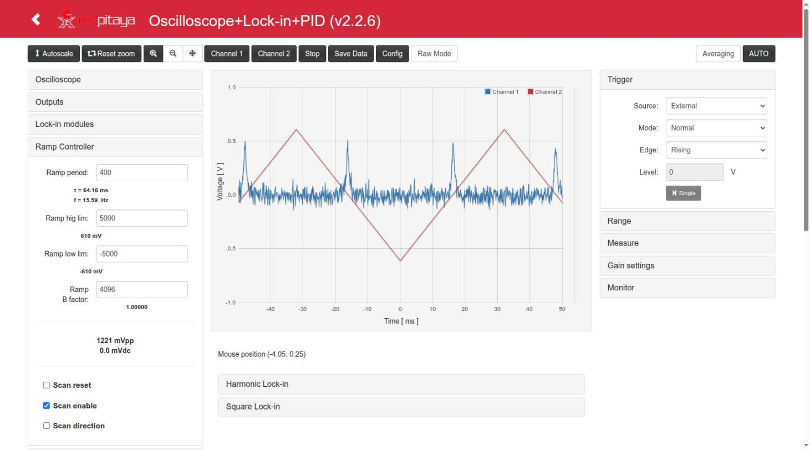

- **Top toolbar**: zoom and acquisition buttons.
- **Left column**: the instruments (Oscilloscope, Outputs, Lock Control, Lock-in modules, Ramp Controller, PIDs
  modules; Lock Control is below Outputs since v2.2.12). Each title opens or closes its panel.
- **Centre**: the plot (Channel 1 blue, Channel 2 red), the mouse position and the displays *Harmonic
  Lock-in* (X, Y, R, φ, F1, F2, F3) and *Square Lock-in* (X, Y, R, φ).
- **Right column**: the scope controls (Trigger, Range, Measure, Gain settings) and the Monitor.

Every change is sent to the board when the field loses focus or Enter is pressed (Escape cancels the edit).
Only changed values are sent. A field left empty or with an invalid text is not sent; the last value comes back.
The mouse wheel over a number field changes it by 1 (SHIFT ×10, CTRL ×100); **the wheel over the plot zooms it**
(no key: both axes, SHIFT: time only, ALT: Y only; a time zoom changes the acquisition window, see the toolbar).

## Panels

### Toolbar

| Button | Action |
|---|---|
| Autoscale | Rescales the **Y axis** to the data on screen, only in the page. Does not end a lock capture. |
| Reset zoom, zoom in/out, pan | Plot navigation. A zoom selects the time window of the acquisition; the decimation (time range 0..6, up to 68.7 s) is chosen from it. Reset zoom (v2.2.9) sets the window from t = 0 to one period of the ramp (Ext Trig = Scan floor / Scan ceil), one period of the harmonic modulation (Ext Trig = harmonic mod., 2520·(hp+1) clocks), one period of the square modulation (Ext Trig = Square mod., 2·(sqp+1) clocks; the harmonic period with sqp = 0) or one whole memory at the current decimation (otherwise), and Y to −1 … 1 V (raw mode −8192 … 8192). Periods of 1.5 s or more: 0.98 × the period, so that every scan is acquired ([Slow scans](#slow-scans)). During a lock capture it first ends it, as AUTO, and uses the restored Ext Trig. The Raw Mode button rescales Y the same way. |
| Mouse wheel on the plot (v2.2.9) | Zoom centred on the mouse, 1.5× per step. **No key:** both axes. **SHIFT** held: time axis only (the cursor becomes a horizontal double arrow ↔). **ALT** held: Y axis only (vertical double arrow ↕; in raw mode the Y range is in counts). The time window is sent to the controller once the wheel stops (250 ms), which chooses the decimation as for any zoom; it stays between 20 ns and 68.7 s. The Y zoom is only in the page (1/2048 … 1000 × full scale). During a lock capture the wheel zoom is only in the page; ending the capture restores the window saved before it. |
| Channel 1 / Channel 2 | Show or hide each channel. |
| Stop | Stops the acquisition. |
| Save Data | Plot data as Python/Numpy, Matlab/Octave or CSV ([Saving data](#saving-data)). |
| Config | Save / load configurations ([below](#saving-and-loading-configurations)). |
| Raw Mode | Values in counts instead of volts (also in the lock-in displays). |
| Averaging | Average inside the decimation. |
| **AUTO** | Auto-set of the scope in the controller (time range, trigger, Y range). Ends a lock capture. Not the same as *Autoscale*. |

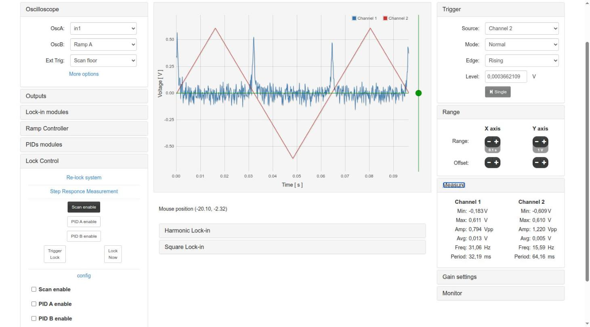

### Oscilloscope

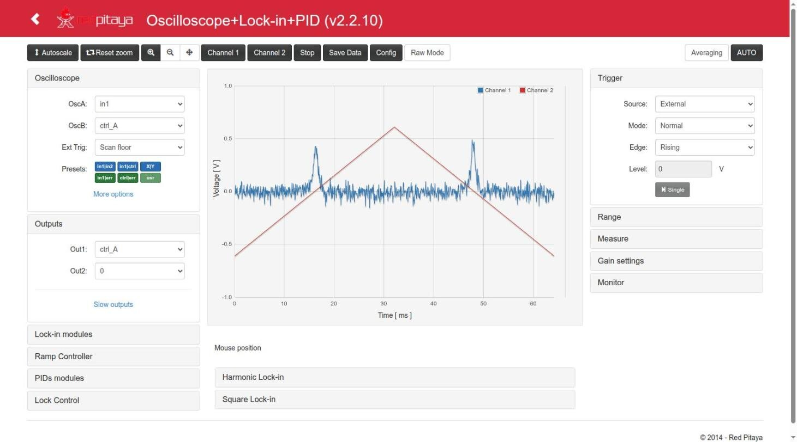

In the screenshot: OscA = in1 (blue), OscB = ctrl_A (red) (preset `in1|ctrl`), Ext Trig = Scan floor, Trigger
External / Normal, after *Reset zoom* (0 … 64.16 ms); Out1 = ctrl_A, Out2 = 0. The triangle of ctrl_A (±0.61 V)
and the two peaks of in1 (≈ 0.45 V, at ≈ 16.3 ms and ≈ 48 ms, on the way up and on the way down).

- **OscA / OscB**: signal shown on Channel 1 / Channel 2: 0, in1, in2, error, ctrl_A, ctrl_B, Ramp A/B,
  pidA/B_in, PID A/B out, the references (sin_ref, cos_ref, cos_1f/2f/3f, sq_ref, sq_quad, sq_phas, square ref
  (bin)), signal_i, Xo, Yo, F1o, F2o, F3o, sqXo, sqYo, sqFo. The fast inputs are seen with `in1`/`in2`.
- **Ext Trig**: event used when the scope trigger *Source* is *External*: None, Pin (DIO0_P), Scan floor, Scan
  ceil, harmonic mod. (start of each period of the harmonic modulation), Square mod., Out of lock, Jump trigger,
  Lock control trig (the lock event; used by Capture Lock).
  Since v2.2.10, picking an Ext Trig other than the current one and not *None* also sets the *Trigger* panel to
  *Source* = External and *Mode* = Normal (one POST). *None* changes nothing else; *Config load*, the end of a
  Capture Lock, *Reset zoom* and *AUTO* keep their own trigger settings.
- **Presets** (v2.2.10): small buttons below Ext Trig that set OscA|OscB in one click: `in1|in2`, `in1|ctrl`
  (in1, ctrl_A), `X|Y` (Xo, Yo) in blue; `in1|err` (in1, error), `ctrl|err` (ctrl_A, error) and `usr` in green.
  They change only the two signals: not the zoom, not the trigger, not a lock capture. `usr` is a pair of your
  own: **double click** on it (or a click while it is not configured; dashed border) opens a dialog with the two
  signals (any signal of the selects); *Accept* saves it in the browser and shows it. The pair is also saved in the
  configs (*Config*: save and download; older configs without it keep the current one). The tooltip of each button
  names its two signals.
- **More options**: *R|Phase Mode* (button disabled in this version) and *Disable anti-aliasing filter* for each
  channel (on by default).

### Outputs

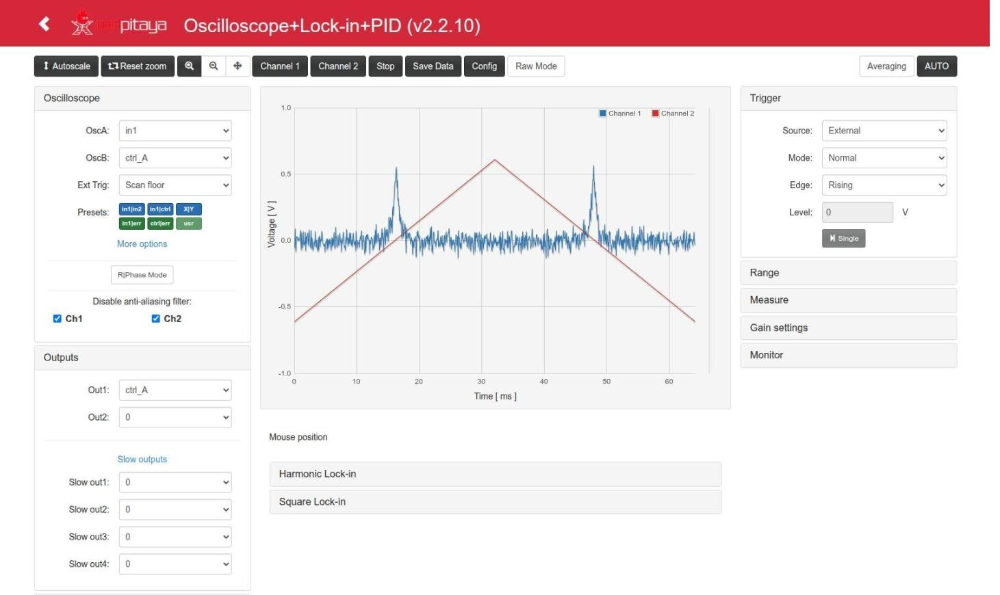

- **Out1 / Out2**: signal sent to each fast output (±1 V): 0, in1, in2, in1−in2, sin_ref (Out1) / cos_ref
  (Out2), cos_1f, cos_2f, cos_3f, sq_ref, sq_quad, sq_phas, PID A out (Out1) / PID B out (Out2), ctrl_A, ctrl_B,
  error, aux_A (Out1) / aux_B (Out2). For a lock, Out1 = ctrl_A (ramp + PID A) is the usual choice. **No
  modulation is added to the outputs**: to modulate the system use the other output (e.g. Out2 = cos_ref), the
  digital pin DIO7_N, or external means.
- **Slow outputs**: four selectors. *Slow out3* and *Slow out4* drive AO2 and AO3 (0..1.8 V, −1 V of the signal →
  0 V); **Slow out1 and Slow out2 have no effect** in this version ([App.md](App.md#inputs-and-outputs)). The slow
  outputs were not measured on 2.0 (a confirmar).

Example of a reference on an output: Out1 = cos_1f with Period 50 (τ = 1.028 ms, f = 972.611 Hz), ramp off, seen
on IN1 after the simulated peak:

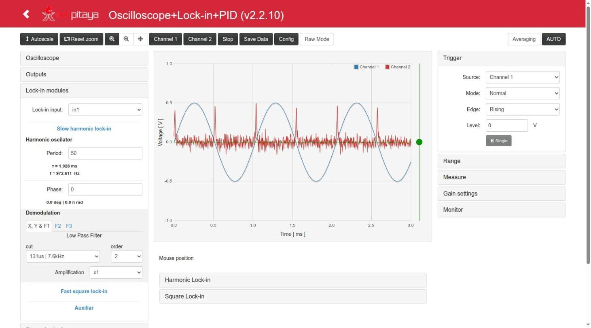

In the screenshot: OscA = cos_1f (±0.5 V), OscB = in1, ≈ 3 periods in 0–3 ms. in1 shows a narrow peak
(≈ 0.3–0.4 V) every time cos_1f crosses the peak of the simulated system: two per period (a 2f component).

### Lock-in modules

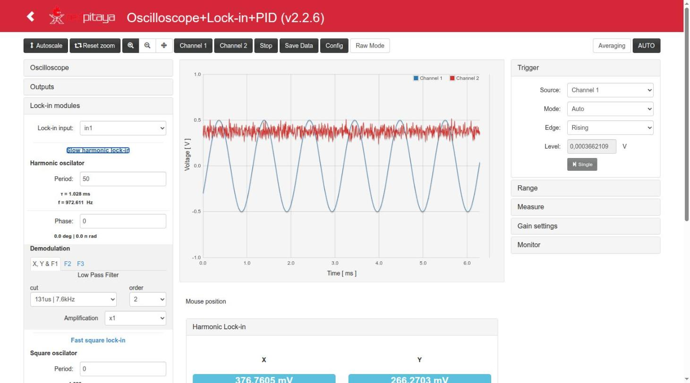

- **Lock-in input**: signal to demodulate, common to both lock-ins (in1, in2, in1−in2, sin_ref, cos_1f, sq_ref,
  sq_phas, Ramp A, square ref (bin), square phas (bin), aux_A, aux_B).
- **Slow harmonic lock-in**:
  - *Harmonic oscillator*: **Period** (`gen_mod_hp`; τ and f below: 0 → 49.603 kHz, 50 → 972.611 Hz) and
    **Phase** of the F1/F2/F3 references (0..2519 = 0..360°, shown in degrees and π rad).
  - *Demodulation*: tabs **X, Y & F1** (one filter and one gain for the three), **F2**, **F3**, each with its low-pass
    filter (*cut* = τ \| 1/τ, *order* OFF/1/2) and *Amplification* (×1 .. ×512).
- **Fast square lock-in**:
  - *Square oscillator*: **Period** (`gen_mod_sqp`; 0 = follow the harmonic oscillator, then τ and f below are
    those of the harmonic period; > 0: period 2·(value+1)·8 ns) and **Phase** (`gen_mod_phase_sq`, ticks).
  - *Demodulation*: one low-pass filter (512 ns .. 17 ms) and *Amplification* for sqX, sqY, sqF.
- **Auxiliar**: *Aux A*, *Aux B* constants (−8192..8191), usable as signals in several selectors.

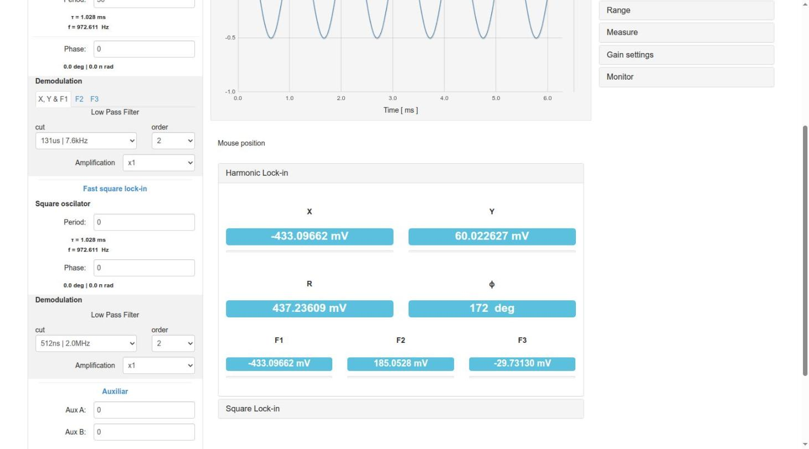

### Ramp Controller

Visible on the left of the [layout screenshot](#layout-of-the-page).

- **Ramp period** (`ramp_step`: ticks per step − 1; below, the resulting period τ and frequency f of the
  triangle), **Ramp hig lim**, **Ramp low lim** (counts, with the value in mV below), **Ramp B factor** (4096 = 1:
  ratio of Ramp B to Ramp A). The amplitude (mVpp) and centre (mVdc) are shown below.
- **Scan reset** (hold at 0), **Scan enable** (the ramp runs; the *Scan enable* button of Lock Control must also be
  on), **Scan direction**.

In the screenshot: ±5000 counts (±610 mV), period 400 → τ = 64.16 ms, f = 15.59 Hz.

### PIDs modules

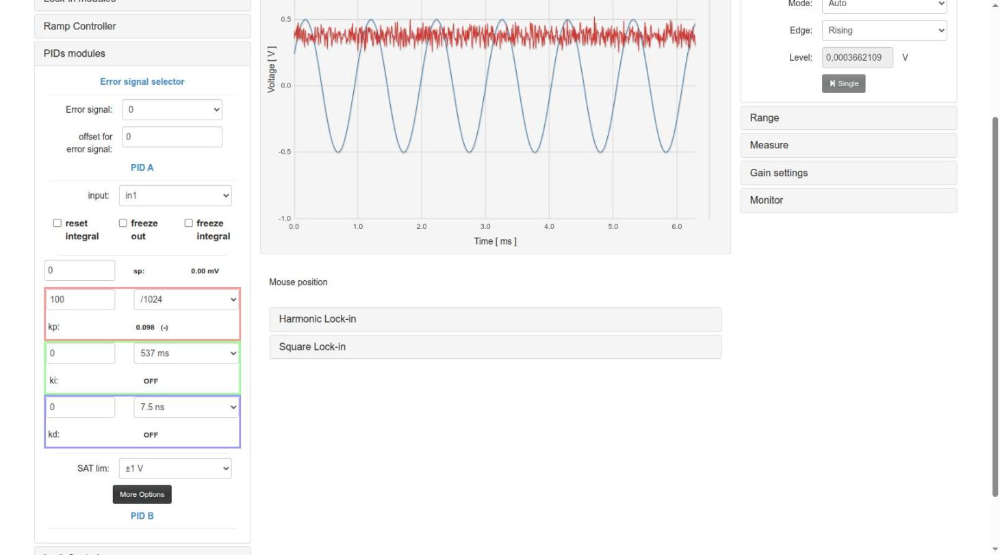

- **Error signal selector**: *Error signal* (0, in1, Xo, F1o, F3o, sqXo, sqYo, sqFo) and its *offset*.
- **PID A / PID B**: *input* (error, signal_i, in1, in2, in1−in2; with *More Options* also Xo, Yo, F1o..F3o,
  sqXo..sqFo, Ramp A, the references, aux_A/B), *reset integral*, *freeze out*, *freeze integral*, and the gains
  *kp*, *ki*, *kd* with the effective value below (kp as a factor, ki and kd as τ and f, and the sign of the
  feedback).
- **More Options** shows the set point *sp* (with mV below), the scale of kp (/1 .. /4096), ki (8 ns .. 9 s; option 4
  is "65 us" since v2.2.6) and kd (7.5 ns .. 491.5 µs), and *SAT lim* (saturation of the integral term, ±122 µV .. ±1 V).

In the screenshot kp = 100 with /1024 gives 0.098.

### Lock Control

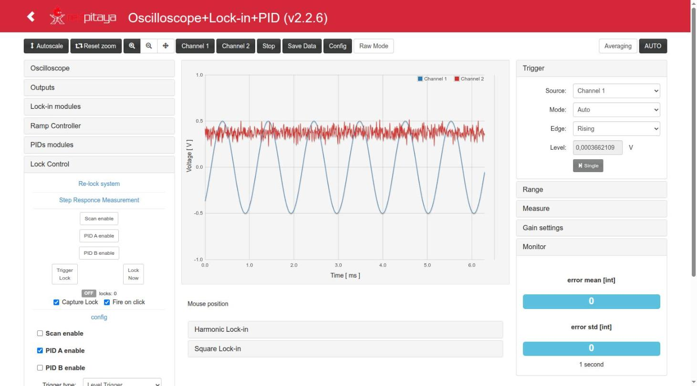

From top to bottom:

- **Re-lock system** and **Step Responce Measurement** (open them with their titles, see below).
- **Scan enable / PID A enable / PID B enable**: buttons with the **effective** state of the ramp and the PIDs
  (dark = on). When nothing is locked a click toggles the manual enable; while LOCKED a click releases the lock
  keeping the other enables.
- **Trigger Lock**: arms the lock; it closes when the trigger of the *config* section happens. **Lock Now**: locks
  at once. Both stay pressed while requested; a second click releases the lock.
- **State label**: OFF / ARMED / LOCKED and the number of locks since the FPGA was loaded.
- **Capture Lock** (on by default): every lock request from the page captures the closing of the loop in the scope
  and freezes the trace. **Fire on click** (on by default): with *Choose from graph*, a click on the plot sets the
  trigger value and fires *Trigger Lock*. Design: [`lock_capture.md`](../lock_in+pid/doc/lock_capture.md).
- **config**:

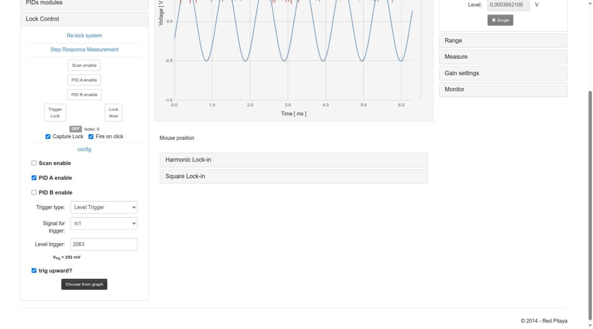

  - *Scan enable*, *PID A enable*, *PID B enable*: what is on **while LOCKED** (usually: scan off, PID A on).
  - *Trigger type*: OFF (only Lock Now), Time trigger, Level Trigger, Level+time Trigger.
  - *Time trigger*: delay after the scan floor, in ticks of 8 ns or with units (`16.58 ms`, `20 s`); shown as T
    below. Up to 4294967295 = 34.36 s (32 bits since v2.2.6).
  - *Signal for trigger* (error, Xo, Yo, F1o..F3o, sqXo..sqFo, signal_i, Ramp A, aux_A, in1, in2, in1−in2, PID A
    out), *Level trigger* (counts or `V`/`mV`, shown in mV below) and *trig upward?*: for the level trigger.
  - **Choose from graph**: the next click on the plot sets the time (Time trigger) or the level (Level trigger). A
    second click on the button (*Cancel*) or Esc cancels it. A red warning appears if the scope is not in
    Normal/Single + External + Scan floor (the only setup where t = 0 of the plot is the scan floor).

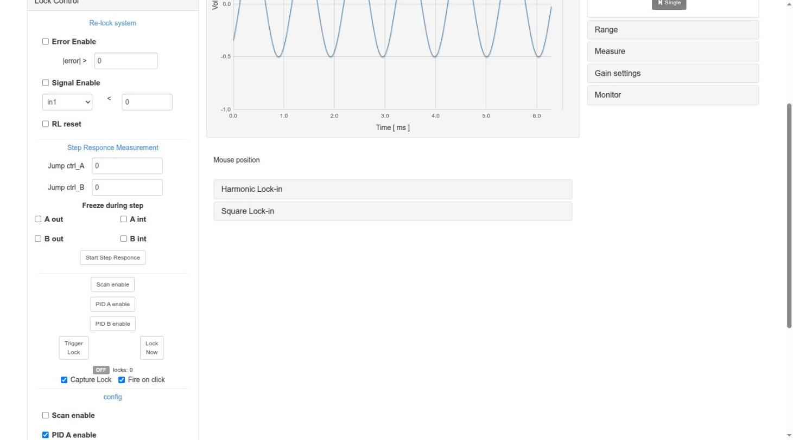

- Re-lock: *Error Enable* with `|error| >` threshold, *Signal Enable* with a signal `<` threshold, *RL reset*.
- Step response: *Jump ctrl_A*, *Jump ctrl_B*, *Freeze during step* (A/B out, A/B int), *Start Step Responce*.
- Neither was tested on 2.0 ([App.md](App.md#re-lock-and-step-response)).

How the lock control works inside: [`lock_control.md`](../lock_in+pid/doc/lock_control.md) and
[Structure.md](Structure.md#lock-control).

### Right panels and displays

- **Trigger**: *Source* (Channel 1, Channel 2, External), *Mode* (Auto, Normal, Single), *Edge*, *Level*, and the
  *Single* button. External uses the *Ext Trig* of the Oscilloscope panel.
  **Auto** (since v2.2.11) waits for the trigger as *Normal* does (the *Level* of the source channel, or the
  *Ext Trig* with Source = External) and forces an acquisition only when no trigger comes within a time limit:
  the largest of 0.25 s, 1.1 × the window + 50 ms and, when the period of the Ext Trig is known (Scan floor /
  Scan ceil with the scan running, harmonic mod. / Square mod.), 1.1 × that period + 50 ms; at most 80 s. So with Ext Trig = Scan
  floor, t = 0 is the scan floor in Auto too (a 30 s scan in a 0…29.4 s window waits up to 33 s and every scan is
  acquired from its floor), and without a trigger (scan stopped or locked with the ramp off, Ext Trig None, a level
  the signal never crosses) the traces keep coming: every 0.25 s plus the acquisition for short windows. As before,
  an Auto acquisition starts at the trigger (no negative times). Up to v2.2.10 Auto triggered at once, at any phase
  of the scan (Scan floor seemed to trigger at the ceiling). The *Level* field and line work in Auto too.
- **Range**: buttons for the X and Y scales and offsets (the X+ button goes up to 68.72 s since v2.2.7; it
  stopped at 10 s before).
- **Measure**: min, max, amplitude, average, frequency and period of each channel.

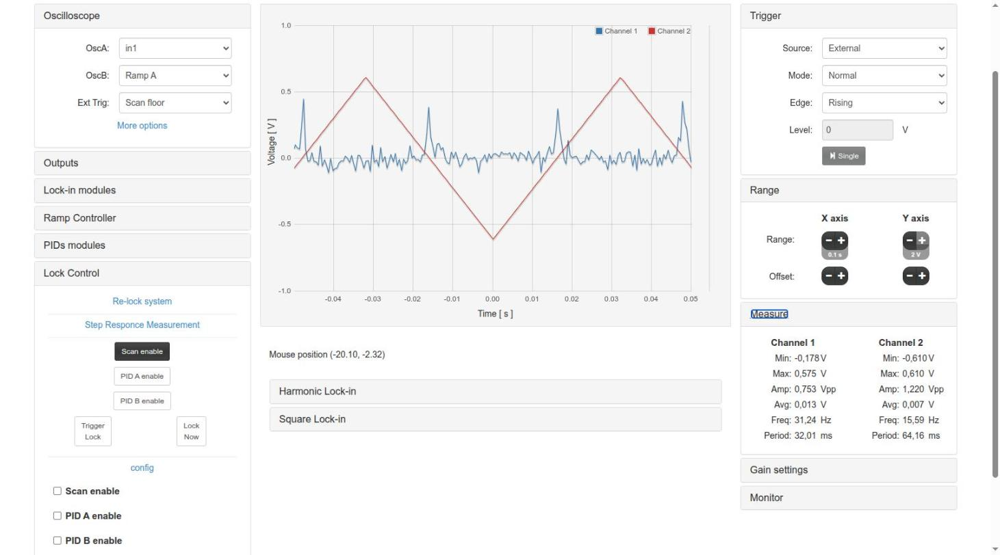

- **Gain settings**: probe attenuation and LV/HV jumper of each input (scale of the display).
- **Monitor**: mean and standard deviation of the error over ~1 s, in counts.
- **Harmonic Lock-in** / **Square Lock-in** (below the plot): X, Y, R, φ (and F1, F2, F3) in volts, computed from
  the 28-bit demodulated values (before the *Amplification*):

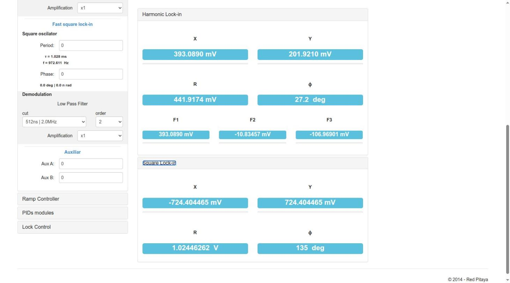

Range 6 of the time axis (68.7 s):

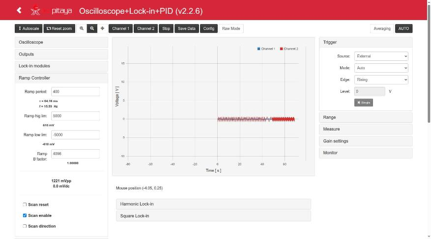

In the screenshot: *Ramp period* 124999 (τ = 20.00 s), OscA in1 / OscB ctrl_A, Ext Trig = None, Trigger Channel 1
/ Auto, window 0 … 68.72 s: the trace is complete from 0.067 s to 68.65 s (1024 points), 3½ triangles of ctrl_A
with the peaks of in1. See also [Slow scans](#slow-scans).

### Slow scans

With windows of 1.5 s or more (e.g. a 30 s ramp) the scope reads its memory while the FPGA is still writing it.
Since v2.2.9 (port of lock_in+pid_harmonic v2.3.23, see the CHANGELOG):

- **Reset zoom** on a scan of period T ≥ 1.5 s (Ext Trig = Scan floor / Scan ceil / harmonic mod. / Square mod.)
  sets the window to 0 … 0.98 × T (at least 50 ms before the next trigger), so that the scope is armed again in
  time and every scan is acquired. Shorter periods keep one whole period.
- The trace is drawn **while it is acquired**, only with valid points of the current acquisition (it starts and
  ends at the valid ones, never mixed with an older lap of the memory, and the previous trace is not left to the
  right). In Normal mode the **whole trace is only seen near the end of each scan**: between the end of the
  window (0.98 × T) and the next scan floor. In Auto mode the same happens for every acquisition (the 68.7 s
  screenshot above shows a whole acquisition just before the next one starts).
- **Capture Lock** works with slow scans (Time trigger, Level trigger and Lock Now): the lock request is held until
  the scope has loaded its **history before the lock** (the part of the window before t = 0; banner "loading the
  scope history before the lock (x s)"), then the lock is applied and the capture is drawn as it is acquired.
  Lock Now on a slow window therefore locks after that history, on purpose.
- (FPGA) A time trigger armed after the ramp was stopped (e.g. right after releasing a lock) waits for the next
  scan floor instead of firing in the middle of the scan.

## Typing values with units

The **Time trigger** and **Level trigger** fields of *Lock Control → config* are text fields that accept a number
with a unit (v2.2.6, from lock_in+pid_harmonic v2.3.16; `parseTrigTime()`, `parseTrigLevel()` in `index.html`):

| Field | Without unit | Units | Range | Examples (tested on the board, v2.2.6) |
|---|---|---|---|---|
| Time trigger | ticks of 8 ns | `s`, `ms`, `us` (`µs`), `ns`, `tick(s)` | 0 .. 4294967295 (34.36 s); larger values are clamped | `16.58 ms` → 2072500, `20 s` → 2500000000, `40 s` → 4294967295 |
| Level trigger | counts | `V`, `mV`, `count(s)` | −8192 .. 8191 | `0.1 V` → 819, `120 mV` → 983, `5085` → 5085 |

An empty or invalid text (`abc`) is not sent: a red hint appears and the last value comes back. Values above 2²⁴
ticks (134 ms) go through the float parameters of the controller and are rounded to the float32 grid (≤ 1 µs).

The other number fields (Period, Phase, Ramp limits, sp, …) are `<input type="number">`: the browser does not let
letters be typed, so the unit conversions that the JavaScript has for them (`ms`, `V`, `deg`, …) cannot be used
from the page ("1 ms" in Period stays 1; `reportes/lock-in_pid.md`, 2.2.5).

## Procedures

These procedures follow the concepts of the published documentation and the tests of `reportes/lock-in_pid.md`.
The example values are those used on the test bench: a system with a resonance (a peak) whose control input is
OUT1 and whose response is measured on IN1.

**A confirmar:** a real lock with this App (closed loop on a system) was not validated on the current bench;
the steps 3 and 4 below were checked only as states, registers and captures of the page, not as a stable lock.

### 1. Scan and see the response of the system

1. **Outputs**: Out1 = `ctrl_A`.
2. **Ramp Controller**: limits ±5000 (±610 mV), period 400 (64.16 ms), *Scan enable* checked.
3. **Lock Control**: *Scan enable* button on, *PID A enable* off.
4. **Oscilloscope**: OscA = `in1`, OscB = `Ramp A` (or `ctrl_A`); Ext Trig = *Scan floor*.
5. **Trigger**: Source *External*, Mode *Normal* (picking an Ext Trig already sets them, v2.2.10). Press
   **Reset zoom**: the window goes from 0 to one period of the ramp (0 … 64.16 ms) and t = 0 is the scan floor.
   The preset `in1|ctrl` sets OscA = in1, OscB = ctrl_A in one click.

The response of the system appears at the same position in every sweep (in the screenshots of the
[layout](#layout-of-the-page) and of the [Oscilloscope](#oscilloscope), two peaks per period, on the way up and down
of the triangle).

### 2. Get an error signal

The PID needs a signal that crosses zero at the point where the system has to stay:

- **With a lock-in** (derivative of the response): modulate the system with a reference (this App does **not** add
  it to OUT1: use e.g. Out2 = `cos_ref` or `sq_ref` summed to the control input of the system outside the board,
  or the digital modulation on DIO7_N), set **Lock-in input** = `in1`, choose the modulation Period, a filter
  well below the modulation frequency, and look at `Xo`/`Yo` (harmonic) or `sqXo`/`sqYo` (square) during the scan.
  Change the *Phase* (or choose X / Y) until one component is a clean dispersive curve with a zero crossing at the
  peak. Then select it as *Error signal* (`Xo`, `F1o`, `F3o`, `sqXo`, `sqYo`, `sqFo`) or directly as PID input
  (`Yo`, `F2o` are only available as PID input).
- **Without modulation** (side of fringe): *Error signal* = `in1` with *offset* = the level of the flank where the
  system has to stay (or PID input `in1` with set point `sp`).

### 3. Close the lock

1. **PID A**: input = error (or the chosen signal), kp and ki with the sign that gives negative feedback around the
   zero crossing (try the other sign if the lock runs away).
2. **Lock Control → config**: while locked, *PID A enable* on and *Scan enable* off.
3. Choose the trigger:
   - **Time trigger**: press *Choose from graph* and click on the point of the scan where the lock must close. With
     *Fire on click* on, the click also fires *Trigger Lock*.
   - **Level trigger**: Signal for trigger = error (or in1), Level = the value just before the crossing, *trig
     upward?* according to the slope. *Choose from graph* takes the level from the click.
   - **Lock Now**: locks immediately wherever the ramp is.
4. Press **Trigger Lock**. The state goes OFF → ARMED → LOCKED in the next sweep; with *Capture Lock* the scope shows
   the closing of the loop (t = 0 is the lock) and keeps it frozen:

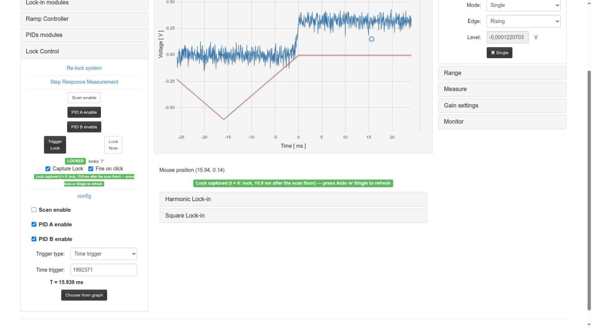

With the level trigger the lock is placed at 30 % of the window:

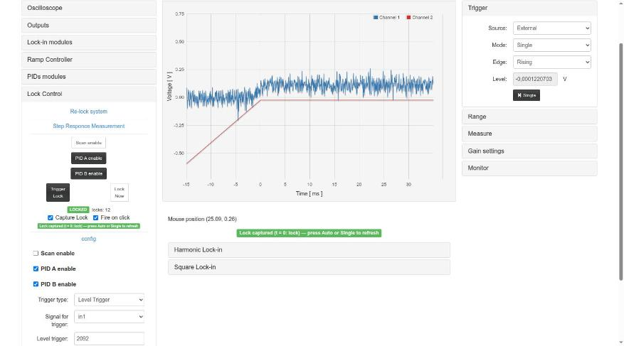

While ARMED (here with a time trigger of 34 s) the page waits for the capture:

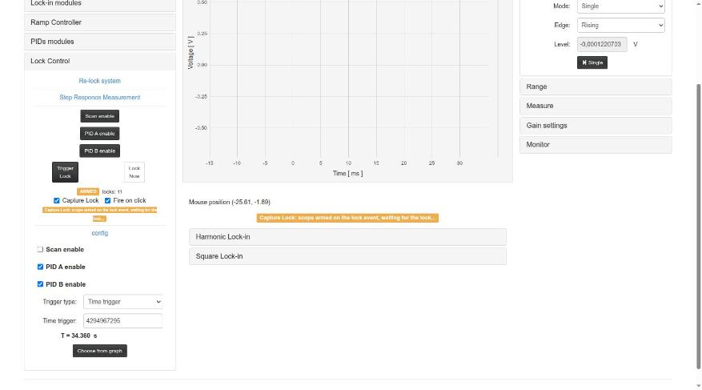

Choose from graph, Trigger Lock, Lock Now and release (GIF):

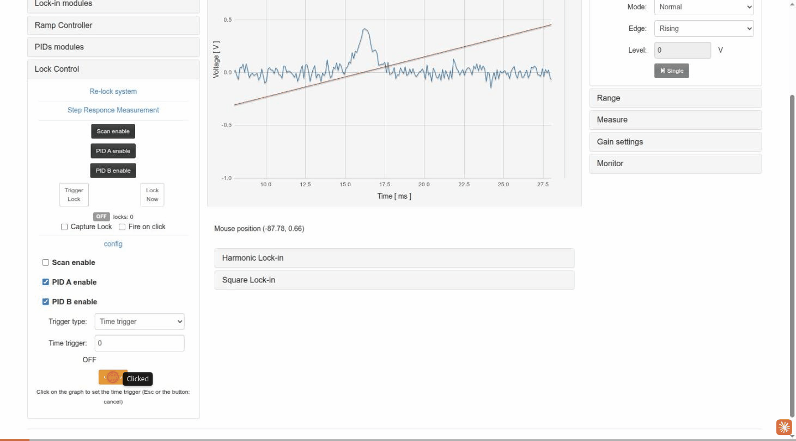

Capture Lock and Fire on click on a frozen capture (GIF, v2.2.10). It shows the **page sequence only**: the PID
gains were 0, so "LOCKED" just stops the ramp and holds ctrl_A where the trigger happened (in1 stays at the level of
that point); it is not a lock of the system. Frames: scan (OFF, Time trigger 0); *Choose from graph*; click on the
peak at 16.31 ms → LOCKED, capture frozen, Time trigger 2039088 (T = 16.313 ms, "16.3 ms after the scan floor");
*Choose from graph* on the capture and a click at t = −2.95 ms (**Fire on click**) → locks 2, Time trigger 1669799
(T = 13.358 ms); **AUTO** ends the capture; a second click on *Trigger Lock* releases, Reset zoom shows the scan
again:

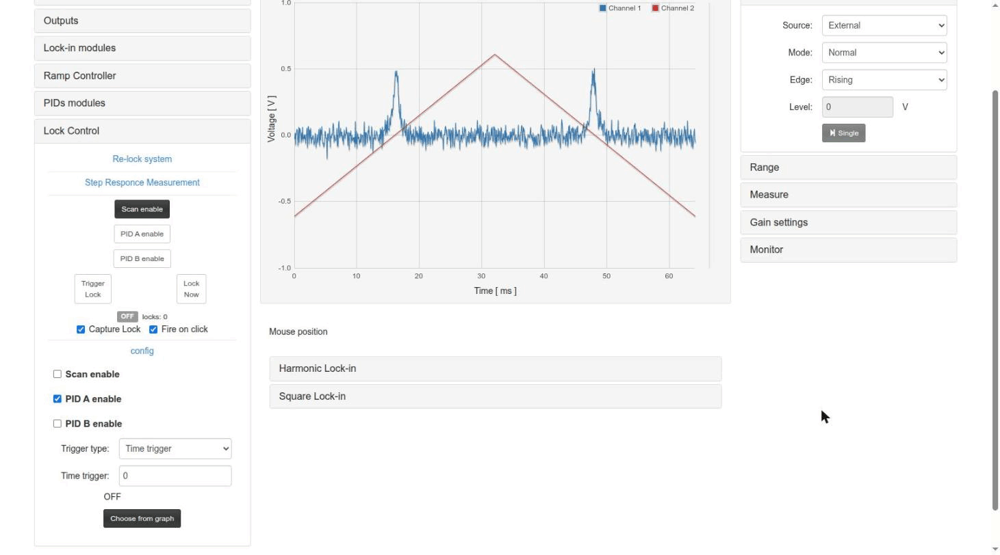

The frozen capture ends (and the scope settings saved before the capture are restored) with trigger mode
Auto/Normal, *Single*, **AUTO**, a change of source or Ext Trig, or unchecking *Capture Lock*. *Autoscale* keeps it.

### 4. Check the lock and release it

1. Set the trigger Mode to **Auto**: the ramp has stopped; OscA = `ctrl_A`, OscB = `error` (the error should stay
   around 0), or OscA = `in1` (the signal should stay at the lock point).
2. The **Monitor** panel shows the mean (≈ 0 when locked) and the std of the error.
3. **Release**: a second click on *Trigger Lock* (or *Lock Now*), or a click on *Scan enable* (restarts the scan
   with the PIDs as they were). The page sends no POST while the lock is held (verified: 0 POST in 30 s LOCKED).

A lock can also be closed and checked without the web page, with `py/lock_from_registers.py` on the board (see
[Remote.md](Remote.md)); the page follows the state (OFF / ARMED / LOCKED) without sending anything.

## Saving and loading configurations

**Config** opens the configuration dialog (the same as in lock_in+pid_harmonic):

- *Save in browser* stores all the parameters (and the Capture Lock / Fire on click preferences) under the *Config
  Name* in the browser (`localStorage`, key `lockConfig_lock_in+pid`). *Save as file* downloads a JSON.
- The list shows the saved configs with *del*, *download* and *load*. *Load file* adds a JSON file to the list.
- **Don't turn on PIDs and Ramp on config loading**: **unchecked by default** (since v2.2.11; up to 2.2.10 it was
  checked). Unchecked, *load* (also of a *Load file*) sets the ramp (*Scan enable* and the Lock Control ramp
  enable) and the PIDs as they are in the config: a config saved while scanning loads scanning. Checked, a loaded
  config never turns them on (useful when the outputs are connected to an experiment). The same option applies to
  the restore of the last config / tab state after a start / *Restart*. A lock request (*Lock Now*, *Trigger Lock*) is never
  loaded. The option is not saved: every page load starts with it unchecked.
- Configs are per browser, not stored on the board. Configs of lock_in+pid_harmonic are not shown (own key since
  v0.2.4).
- **Load last config on init** (since v2.2.12): **checked by default**; the choice is kept in the browser
  (`localStorage`, key of this App). The page saves the current settings automatically every ~2 s (the *last
  config*, also in `localStorage`). Checked, each time the page starts the App (main menu, new tab, F5) it restores
  the last config; unchecked, the App starts with its defaults. The ramp / PIDs of the restored config follow the
  option above; a lock request is never restored.
- **Load last config** / **Reset to defaults** (since v2.2.12): close the dialog and restart the App (the page reloads,
  the FPGA is reloaded: outputs and lock are reset) with the last config / with the default parameters of the App (as
  a fresh start: lock open, ramp stopped, PID gains 0), whatever the checkbox says. After *Reset to defaults* (or an
  open with the box unchecked) the last config is kept until a parameter is changed, so *Load last config* brings it
  back.
- **Time window** (v2.2.6): *load* applies the window of the config in the units it was saved with (a config saved
  in ms loaded with the scope in µs keeps its window in ms; up to v2.2.5 it was applied in the units of the
  server). The scale values derived by the server and the read-only values are not sent.

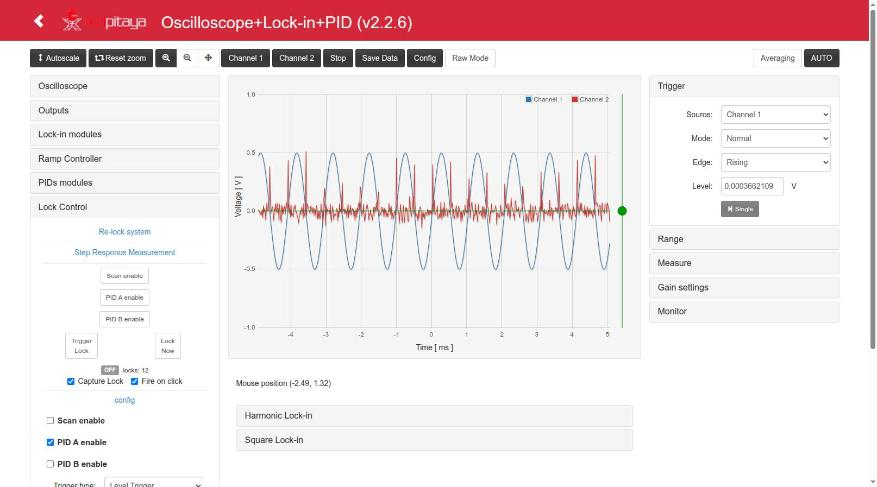

## Saving data

*Save Data* gives the data of the plot as Python/Numpy vectors, Matlab/Octave vectors or CSV (save as a file, copy
or show).

## Several clients and Restart

Only one browser tab should control the board. When another client (another tab, the main menu, another App) takes
the board, the page stops polling and shows a dialog; *Restart* restarts the App and restores the state of the tab (with *Load last config on init* checked or not):

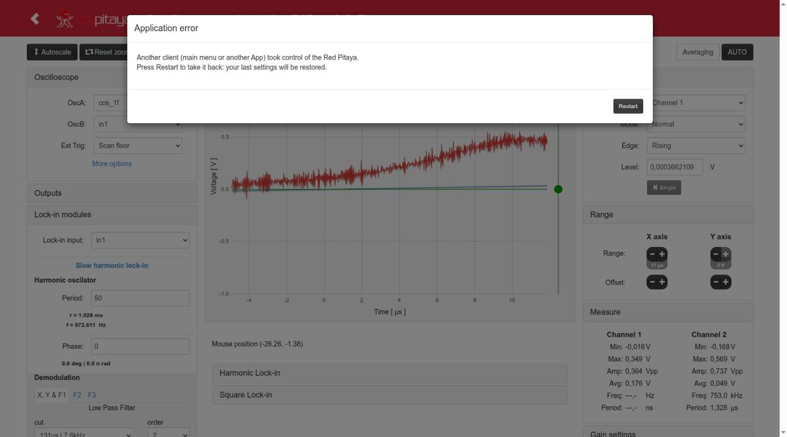

If the App was stopped from outside (e.g. `bazaar?stop=`), the open page starts it again and restores its state.
On Ecosystem 2.0 the page enters a "cautious mode" when the board answers slowly, and waits until it answers fast
again.

## Known limitations of the interface

- **Slow out1 / Slow out2** have no effect; the **R|Phase Mode** button is disabled.
- *Time trigger* values above 2²⁴ ticks (134 ms) set from the page are rounded to the float32 grid (≤ 1 µs).
- Fixed in v2.2.7 (seen in v2.2.6): Time / Level written from Python (`lock_from_registers.py`) did not appear in
  the page and were rewritten at the next change of a lock parameter ([Structure.md](Structure.md#lock-control));
  AUTO with the lock closed (only noise) chose a window of 0…139 ns (minimum 1 µs now); the τ/f text of
  *Ramp period* was not refreshed with the wheel; the X+ button of *Range* stopped at 10 s.
- Each change made in the page is a `POST /data`, and on Ecosystem 2.0 each one leaves an open connection in the
  nginx of the board ([Remote.md](Remote.md#the-post-data-interface-of-the-ecosystem)).

These items are listed for devAgent in `docAgent.md`.
