# Using the App from the web interface

How to use `lock_in+pid` **v2.2.16** (branch `master`) from the browser, panel by panel, and the usual procedures: scan, see a
peak, get an error signal, close a lock and check it. Technical data of each instrument is in
[App.md](App.md); registers in [FPGA.md](FPGA.md). The published documentation of this App has a longer,
illustrated description of the interface: https://marceluda.github.io/rp_lock-in_pid/

- [Opening the App](#opening-the-app)
- [Layout of the page](#layout-of-the-page)
- [Panels](#panels)
  - [Toolbar](#toolbar) ([Reset zoom: whole period / rising half](#reset-zoom-whole-period--rising-half)) ·
    [Oscilloscope](#oscilloscope) · [Outputs](#outputs) · [Lock-in modules](#lock-in-modules) ·
    [Ramp Controller](#ramp-controller) ([Tabs period and freq](#tabs-period-and-freq), [Lock osc. screen](#lock-osc-screen)) ·
    [PIDs modules](#pids-modules) ·
    [Lock Control](#lock-control) · [Right panels and displays](#right-panels-and-displays) · [Slow scans](#slow-scans)
- [Typing values with units](#typing-values-with-units)
- [Procedures](#procedures)
  1. [Scan and see the response of the system](#1-scan-and-see-the-response-of-the-system)
  2. [Get an error signal](#2-get-an-error-signal)
  3. [Close the lock](#3-close-the-lock)
  4. [Check the lock and release it](#4-check-the-lock-and-release-it)
- [Saving and loading configurations](#saving-and-loading-configurations)
- [Saving data](#saving-data)
- [Several clients and Restart](#several-clients-and-restart)
- [Known limitations of the interface](#known-limitations-of-the-interface)

Screenshots: RP2 (RedPitaya_OS 2.04-35), the system scanned is a simulated peak made by `dummy_simulator` on a
second board (OUT1 → IN1 of the other board and back). v2.2.10-23 (2026-10-16, testAgent): the Oscilloscope /
Outputs panels, the cos_1f example, the 68.7 s range and the Capture Lock + Fire on click GIF, with a configuration
built from the defaults of the page (Out1 = ctrl_A, ramp 400 triangle ±5000, OscA in1 / OscB ctrl_A, Ext Trig Scan
floor, **kp = ki = 0**: no real lock). v2.2.5 / v2.2.6-14 (2026-10-10): the rest, taken by testAgent during the tests
of `reportes/lock-in_pid.md` and by docAgent while writing this page (only opening panels; the values seen are those
left on the board). v2.2.16-31 (2026-11-13, testAgent, report `reportes/lock-in_pid/2026-11-13_1806_v2216.md` in the
Apps root): the *Ramp Controller* tabs, *Lock osc. screen* and *Reset zoom*; in those the ramp was internal (Channel 2 =
Ramp A) and in1 (Channel 1) is only the signal of the bench, not a response to that ramp. Some screenshots taller than
the browser window are two screenshots of the same page joined.

## Opening the App

Install the App (see the [README](../README.md#installation)) and open `http://rp-XXXXXX.local/lock_in+pid/`
(or choose "Oscilloscope+Lock-in+PID" in the main menu). The page starts the App (loads the FPGA and the C
controller) if it is not already loaded, and restores the last settings used in this browser (any tab) when **Load last config on init** is checked
(default, Config dialog, since v2.2.12); unchecked, the App starts with its default parameters (see [Saving and loading
configurations](#saving-and-loading-configurations)). If the App is already running (e.g. another tab), the page shows its current state.
Use a single tab per board (see [Several clients and Restart](#several-clients-and-restart)).

## Layout of the page

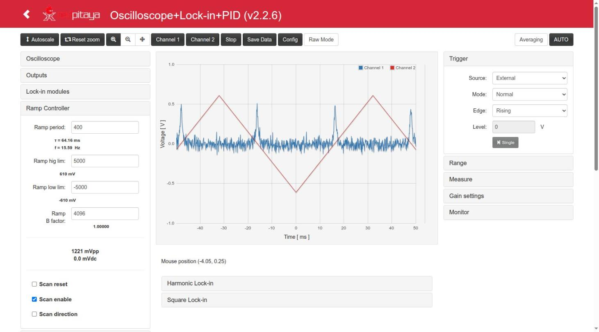

- **Top toolbar**: zoom and acquisition buttons.
- **Left column**: the instruments (Oscilloscope, Outputs, Lock Control, Lock-in modules, Ramp Controller, PIDs
  modules; Lock Control is below Outputs since v2.2.12). Each title opens or closes its panel.
- **Centre**: the plot (Channel 1 blue, Channel 2 red), the mouse position and the displays *Harmonic
  Lock-in* (X, Y, R, φ, F1, F2, F3) and *Square Lock-in* (X, Y, R, φ).
- **Right column**: the scope controls (Trigger, Range, Measure, Gain settings) and the Monitor.

Every change is sent to the board when the field loses focus or Enter is pressed (Escape cancels the edit).
Only changed values are sent. A field left empty or with an invalid text is not sent; the last value comes back.
The mouse wheel over a number field changes it by 1 (SHIFT ×10, CTRL ×100); **the wheel over the plot zooms it**
(no key: both axes, SHIFT: time only, ALT: Y only; a time zoom changes the acquisition window, see the toolbar).

## Panels

### Toolbar

| Button | Action |
|---|---|
| Autoscale | Rescales the **Y axis** to the data on screen, only in the page. Does not end a lock capture. |
| Reset zoom, zoom in/out, pan | Plot navigation. A zoom selects the time window of the acquisition; the decimation (time range 0..6, up to 68.7 s) is chosen from it. Reset zoom (v2.2.9) sets the window from t = 0 to one period of the ramp (Ext Trig = Scan floor / Scan ceil; with Scan floor and Source External, a second click gives the rising half, [below](#reset-zoom-whole-period--rising-half); with *Lock osc. screen* on, its window), one period of the harmonic modulation (Ext Trig = harmonic mod., 2520·(hp+1) clocks), one period of the square modulation (Ext Trig = Square mod., 2·(sqp+1) clocks; the harmonic period with sqp = 0) or one whole memory at the current decimation (otherwise), and Y to −1 … 1 V (raw mode −8192 … 8192). Periods of 1.5 s or more: 0.98 × the period, so that every scan is acquired ([Slow scans](#slow-scans)). During a lock capture it first ends it, as AUTO, and uses the restored Ext Trig. The Raw Mode button rescales Y the same way. |
| Mouse wheel on the plot (v2.2.9) | Zoom centred on the mouse, 1.5× per step. **No key:** both axes. **SHIFT** held: time axis only (the cursor becomes a horizontal double arrow ↔). **ALT** held: Y axis only (vertical double arrow ↕; in raw mode the Y range is in counts). The time window is sent to the controller once the wheel stops (250 ms), which chooses the decimation as for any zoom; it stays between 20 ns and 68.7 s. The Y zoom is only in the page (1/2048 … 1000 × full scale). During a lock capture the wheel zoom is only in the page; ending the capture restores the window saved before it. With *Lock osc. screen* on (v2.2.16) the wheel without keys zooms Y only and the time zoom (SHIFT, box, X±) changes the ramp limits instead ([Lock osc. screen](#lock-osc-screen)). |
| Channel 1 / Channel 2 | Show or hide each channel. |
| Stop | Stops the acquisition. |
| Save Data | Plot data as Python/Numpy, Matlab/Octave or CSV ([Saving data](#saving-data)). |
| Config | Save / load configurations ([below](#saving-and-loading-configurations)). |
| Raw Mode | Values in counts instead of volts (also in the lock-in displays). Also the *Level* of the scope trigger (field, slider and line; −8192 … 8191, unit `counts`): switching Raw Mode converts it (counts = V × 8192 / full scale) and sets Y to −8192 … 8192 / −1 … 1 V. Before v2.2.14 the level in Raw Mode was taken as volts by the controller (Normal / Single did not trigger). |
| Averaging | Average inside the decimation. |
| **AUTO** | Auto-set of the scope in the controller (time range, trigger, Y range). Ends a lock capture. Not the same as *Autoscale*. The trigger level is set to the middle of the signal (since v2.2.15 also with a calibration offset of the input; whole counts in Raw Mode). |

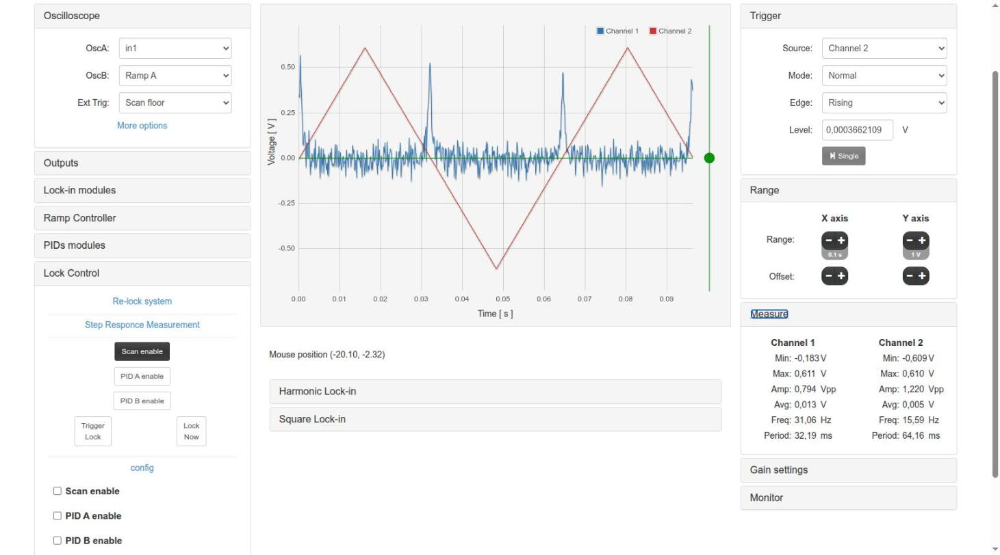

#### Reset zoom: whole period / rising half

Since v2.2.16 (port of `lock_in+pid_plus` 2.2.0, as `lock_in+pid_harmonic` 2.3.31), with *Source* = External, *Ext
Trig* = **Scan floor** (and *Lock osc. screen* off), **each click of Reset zoom alternates** between the whole period
and the rising half (`resetZoomCycleNext()`, `index.html` l. 3389, used by `resetZoom()`, l. 6354; this App has the
triangle only, so the condition on the waveform of the other Apps is always true here):

1. first click: 0 … T (one whole period, as before; 0 … 0.98 T for T ≥ 1.5 s, see [Slow scans](#slow-scans));
2. next click: **0 … T/2**, the rise from the scan floor to the top (the triangle always rises after the floor,
   [App.md](App.md#ramp-generator-scan));
3. next click: whole period again, and so on, while the zoom is not touched.

Anything else in between starts the cycle again, so the next click gives the whole period: a zoom by hand (box, wheel
with or without SHIFT / ALT, pan, X± / Y±, Autoscale, the scope presets), a change of the trigger (*Source*, *Mode*,
*Ext Trig*) or of the ramp (any tab, the zoom of *Lock osc. screen*, another client, a config load: step and limits
are compared too), or a window on the plot different from the one of the last click (`resetZoomCycleKey()`,
l. 3384-3387).

With *Scan ceil* (its first half after the trigger is the fall), *harmonic mod.*, *Square mod.* or another *Ext Trig*
or *Source*, Reset zoom gives one period / one memory on every click, as before; with *Lock osc. screen* on, it gives
the window of Lock osc. screen. The title of the button says so (`index.html` l. 7330). Measured on the board (v2.2.16,
±4000 at 100 Hz): the clicks gave 0 … 9.984 / 4.992 ms alternating (twice); after a wheel zoom the next click gave
9.984 ms again; Scan ceil: 9.984 ms on 3 of 3 clicks; *harmonic mod.* with hp 0: 0 … 20.16 µs (one period of the
49.6 kHz modulation, 2 of 2); *Square mod.* with sqp 0: 0 … 20.16 µs (the harmonic period), with sqp 49: 0 … 0.8 µs
(100 cycles), never alternating.

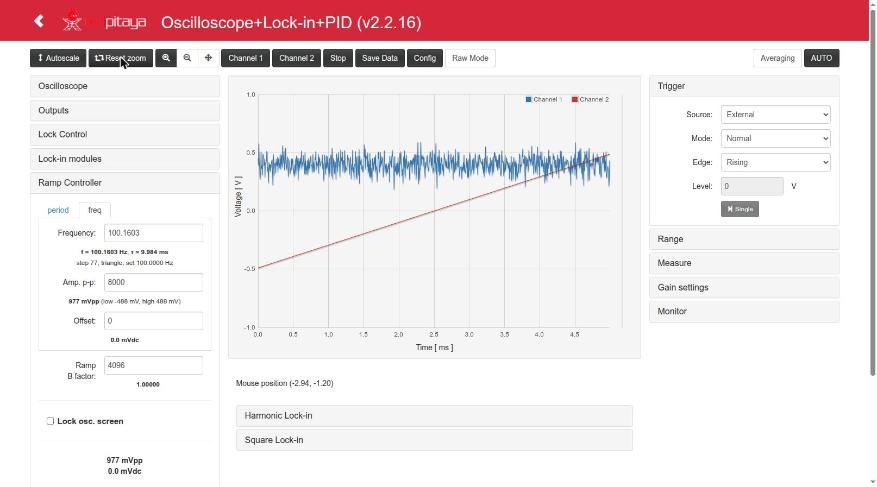

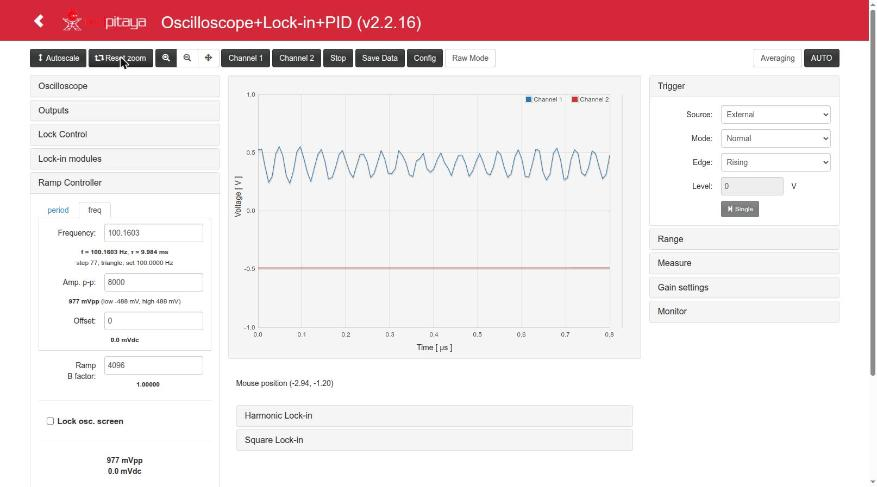

When a click changes the time units (e.g. from a window in seconds to ms) the server repeats the new window in every
`GET /data` until the next POST; since v2.2.16 the page applies that once and never over a window that it has just
set itself, also when the POST of the first click times out and is retried (nginx of Ecosystem 2.0 hangs ~2 s every
few minutes): [Structure.md](Structure.md#time-window-of-the-plot-and-force-x). Board tests: 20/20 quick second clicks
from an axis in seconds stayed at 0 … 4.992 ms, and 21/21 with a timed-out POST that the server did serve
(`reportes/lock-in_pid/2026-11-13_2312_forcex_retry2.md`).

### Oscilloscope

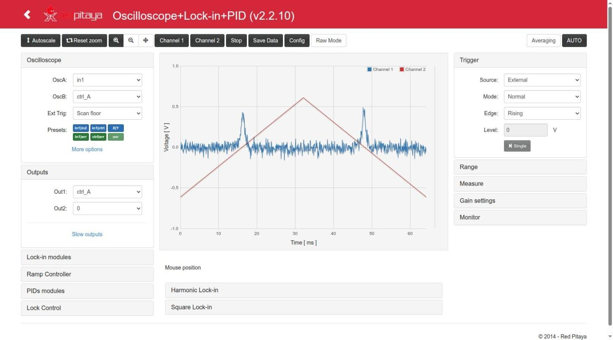

In the screenshot: OscA = in1 (blue), OscB = ctrl_A (red) (preset `in1|ctrl`), Ext Trig = Scan floor, Trigger
External / Normal, after *Reset zoom* (0 … 64.16 ms); Out1 = ctrl_A, Out2 = 0. The triangle of ctrl_A (±0.61 V)
and the two peaks of in1 (≈ 0.45 V, at ≈ 16.3 ms and ≈ 48 ms, on the way up and on the way down).

- **OscA / OscB**: signal shown on Channel 1 / Channel 2: 0, in1, in2, error, ctrl_A, ctrl_B, Ramp A/B,
  pidA/B_in, PID A/B out, the references (sin_ref, cos_ref, cos_1f/2f/3f, sq_ref, sq_quad, sq_phas, square ref
  (bin)), signal_i, Xo, Yo, F1o, F2o, F3o, sqXo, sqYo, sqFo. The fast inputs are seen with `in1`/`in2`.
- **Ext Trig**: event used when the scope trigger *Source* is *External*: None, Pin (DIO0_P), Scan floor, Scan
  ceil, harmonic mod. (start of each period of the harmonic modulation), Square mod., Out of lock, Jump trigger,
  Lock control trig (the lock event; used by Capture Lock).
  Since v2.2.10, picking an Ext Trig other than the current one and not *None* also sets the *Trigger* panel to
  *Source* = External and *Mode* = Normal (one POST). *None* changes nothing else; *Config load*, the end of a
  Capture Lock, *Reset zoom* and *AUTO* keep their own trigger settings.
- **Presets** (v2.2.10): small buttons below Ext Trig that set OscA|OscB in one click: `in1|in2`, `in1|ctrl`
  (in1, ctrl_A), `X|Y` (Xo, Yo) in blue; `in1|err` (in1, error), `ctrl|err` (ctrl_A, error) and `usr` in green.
  They change only the two signals: not the zoom, not the trigger, not a lock capture. `usr` is a pair of your
  own: **double click** on it (or a click while it is not configured; dashed border) opens a dialog with the two
  signals (any signal of the selects); *Accept* saves it in the browser and shows it. The pair is also saved in the
  configs (*Config*: save and download; older configs without it keep the current one). The tooltip of each button
  names its two signals.
- **More options**: *R|Phase Mode* (button disabled in this version) and *Disable anti-aliasing filter* for each
  channel (on by default).

### Outputs

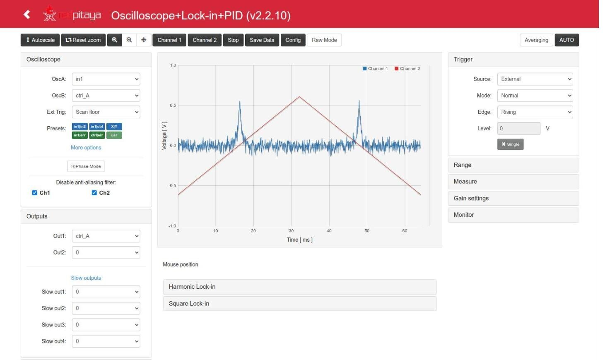

- **Out1 / Out2**: signal sent to each fast output (±1 V): 0, in1, in2, in1−in2, sin_ref (Out1) / cos_ref
  (Out2), cos_1f, cos_2f, cos_3f, sq_ref, sq_quad, sq_phas, PID A out (Out1) / PID B out (Out2), ctrl_A, ctrl_B,
  error, aux_A (Out1) / aux_B (Out2). For a lock, Out1 = ctrl_A (ramp + PID A) is the usual choice. **No
  modulation is added to the outputs**: to modulate the system use the other output (e.g. Out2 = cos_ref), the
  digital pin DIO7_N, or external means.
- **Slow outputs**: four selectors. *Slow out3* and *Slow out4* drive AO2 and AO3 (0..1.8 V, −1 V of the signal →
  0 V); **Slow out1 and Slow out2 have no effect** in this version ([App.md](App.md#inputs-and-outputs)). The slow
  outputs were not measured on 2.0 (a confirmar).

Example of a reference on an output: Out1 = cos_1f with Period 50 (τ = 1.028 ms, f = 972.611 Hz), ramp off, seen
on IN1 after the simulated peak:

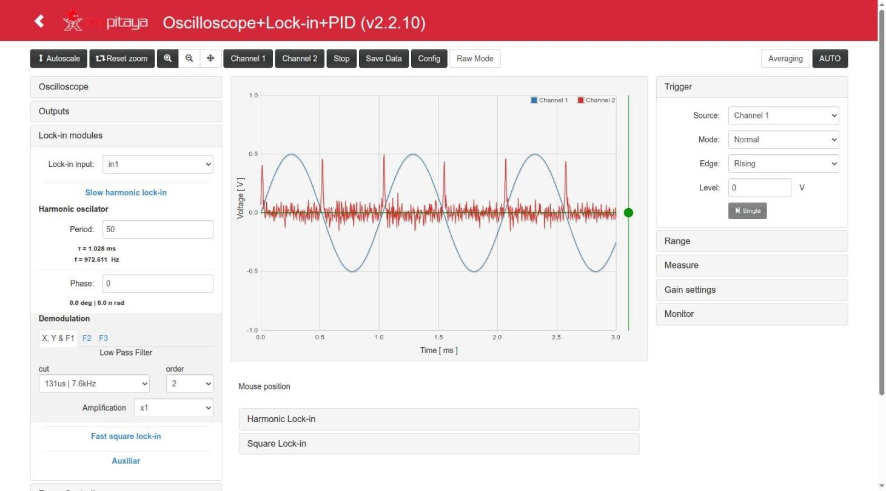

In the screenshot: OscA = cos_1f (±0.5 V), OscB = in1, ≈ 3 periods in 0–3 ms. in1 shows a narrow peak
(≈ 0.3–0.4 V) every time cos_1f crosses the peak of the simulated system: two per period (a 2f component).

### Lock-in modules

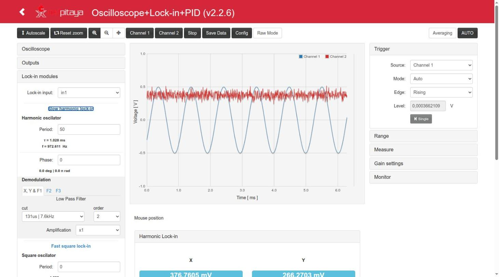

- **Lock-in input**: signal to demodulate, common to both lock-ins (in1, in2, in1−in2, sin_ref, cos_1f, sq_ref,
  sq_phas, Ramp A, square ref (bin), square phas (bin), aux_A, aux_B).
- **Slow harmonic lock-in**:
  - *Harmonic oscillator*: **Period** (`gen_mod_hp`; τ and f below: 0 → 49.603 kHz, 50 → 972.611 Hz) and
    **Phase** of the F1/F2/F3 references (0..2519 = 0..360°, shown in degrees and π rad).
  - *Demodulation*: tabs **X, Y & F1** (one filter and one gain for the three), **F2**, **F3**, each with its low-pass
    filter (*cut* = τ \| 1/τ, *order* OFF/1/2) and *Amplification* (×1 .. ×512).
- **Fast square lock-in**:
  - *Square oscillator*: **Period** (`gen_mod_sqp`; 0 = follow the harmonic oscillator, then τ and f below are
    those of the harmonic period; > 0: period 2·(value+1)·8 ns) and **Phase** (`gen_mod_phase_sq`, ticks).
  - *Demodulation*: one low-pass filter (512 ns .. 17 ms) and *Amplification* for sqX, sqY, sqF.
- **Auxiliar**: *Aux A*, *Aux B* constants (−8192..8191), usable as signals in several selectors.

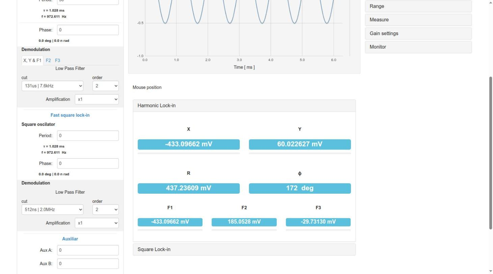

### Ramp Controller

Since **v2.2.16** (the Ramp Controller of `lock_in+pid_plus` 2.2.0, as in `lock_in+pid_harmonic` 2.3.31; web page
only) the panel has two tabs, *period* and *freq*, and a *Lock osc. screen* option. The ramp of the FPGA
(`gen_ramp.v`, triangle only) and its registers are the same as before (CHANGELOG v2.2.16). The relation between the
registers and the physical ramp (period, frequency, amplitude, offset) is in [App.md](App.md#ramp-generator-scan).

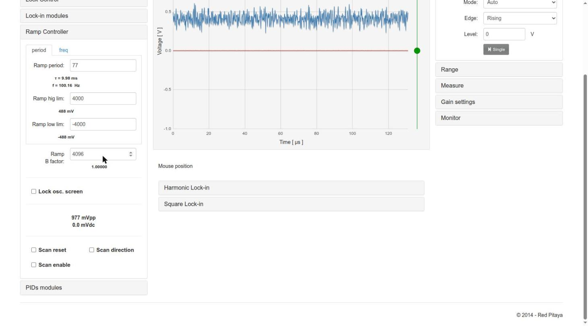

Layout of the panel (top to bottom, `index.html` l. 8630-8827):

- the tabs **period | freq**; the fields of the active tab are inside a box closed by the grey line of the tabs
  (1 px `#dddddd`, CSS `.ramp-tab-pane`, l. 37-46), so it is clear which controls belong to the tab;
- **Ramp B factor** (4096 = 1: ratio of Ramp B to Ramp A; outside the tabs, as before);
- **Lock osc. screen** (checkbox, between two separators, with a short status text below);
- the amplitude (mVpp) and centre (mVdc) of the ramp;
- the three checkboxes in **two columns** (l. 8788-8813): *Scan reset* / *Scan enable* on the left, *Scan direction*
  on the right. *Scan reset* holds the ramp at 0; *Scan enable* runs it (the *Scan enable* button of Lock Control must
  also be on); *Scan direction* is the slope after a *Scan reset* (a change reverses the slope at that moment; after
  the scan floor the triangle always rises, see [App.md](App.md#ramp-generator-scan)). There is **no *Sawtooth*
  checkbox**: this App has the triangle only.

Labels in mV that round to zero show "0 mV", never "-0 mV" (`toFixedNz()`, l. 1996; also Vtrg of the
lock trigger).

#### Tabs period and freq

Only the active tab is visible, so there is only one way of editing the ramp at a time. Clicking the other tab
first applies the edit in progress (as leaving the field) and then **loads the fields of the new tab from the
parameters of the board** (including changes made by another client or a config load); `rampTabSet()`,
`index.html` l. 3676. The last tab used is kept in the browser (`localStorage`, key `lockin_ramp_tab_lock_in+pid`,
`ramp_tab_key` l. 3652) and comes back after a reload.

**Tab period**:

| Field | Units | What it does |
|---|---|---|
| **Ramp period** | `ramp_step` (clock ticks per step − 1), or **the whole period** with a unit: `s`, `seg`, `ms`, `us` (`10 ms`, `0.5 s`, `10ms`; decimal point or comma) | A number alone is the step. A period is converted to the step whose whole period *T* (below) is the nearest one (`rampStepForPeriod()` / `rampParseStep()`, l. 3449-3470) |
| **Ramp hig lim**, **Ramp low lim** | counts (8192 = 1 V) | Limits of the ramp. Below each field: the limit in mV. They do not accept `mV` / `V` from the page (see [Known limitations](#known-limitations-of-the-interface)); the *freq* tab does |

The period of *Ramp period* is that of the whole triangle, from scan floor to scan floor:

$$
T = N\,(\mathrm{step}+1)\cdot 8\ \mathrm{ns},\qquad N = 2\,(\mathrm{hig}-\mathrm{low})
$$

so it depends on the limits.

- **Enter or leaving the field** sends the value (one POST) and rewrites the field in steps (`77`, `3905`…). While
  typing nothing is sent; the text below already shows the τ / f of what is typed (a preview). Escape restores the
  previous value.
- A text that is not valid (`10 kg`, `abc`, a negative value), or a period with *Ramp hig lim* = *Ramp low lim*, is
  not sent: a red hint appears below ("? steps, or a period with units: s, ms, us" or "? a period needs Ramp hig
  lim &gt; Ramp low lim", l. 2053-2056) and the last value comes back.
- The step is limited to **0 … 2147483520** ($2^{31}-128$, `ramp_step_max`, l. 3427) and rounded as the float32
  parameter of the controller (above $2^{24}$ only every 2nd, 4th … 128th integer exists): `4294967295` or `1e6 s`
  give 2147483520.
- Mouse wheel ±1, SHIFT ×10, CTRL ×100, both ×1000 (above $2^{24}$ the wheel ±1 does not move the step, see
  [Known limitations](#known-limitations-of-the-interface)).
- Below the field: τ (the whole period) and f of the ramp.
- No tooltip on the label nor the input; a click on the label "Ramp period" opens the help (l. 1962-1966).

Up to v2.2.15 the field was an `<input type="number">`, so a period with units never reached the page, and the old
conversion took (hig − low) steps, half the period of the triangle.

Measured on the board with v2.2.16 (±4000): `10 ms` + Enter → step 77 (τ = 9.98 ms; no POST while typing, one with
Enter); `4294967295` → 2147483520; `10 kg` restores the value. The periods measured on the scope trace with the same
page code and the same triangle (`lock_in+pid_plus` 2.2.0-rc2, `reportes/lock-in_pid_plus/2026-11-13_0747_v220rc2.md`;
its `gen_ramp.v` has the same triangle logic, [App.md](App.md#ramp-generator-scan)):

| Limits (N) | Typed | Step | T | T measured |
|---|---|---|---|---|
| ±4000 (16000) | `10 ms` | 77 | 9.984 ms | 9.98396 ms |
| ±4000 | `0.5 s` | 3905 | 499.968 ms | 0.49998 s |
| 1000 / −3000 (8000) | `10 ms` | 155 | 9.984 ms | 9.98399 ms |

**Tab freq**:

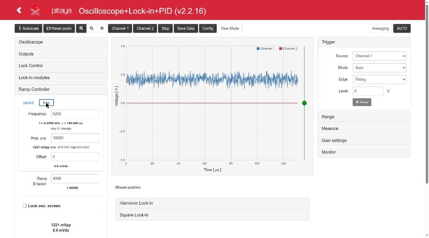

| Field | Units | What it does |
|---|---|---|
| **Frequency** | Hz, or with units: `2.5 kHz`, `10 Hz`, `500 mHz`, `1e3`, `1.5M` (`parseRampFreq()`, l. 3523; `abc`, `-5` are rejected) | Enter (or leaving the field) sets the `ramp_step` whose frequency is the **nearest one** to the value typed, for the current amplitude (`rampStepForFreq()`, l. 3475). The field then shows the **real** frequency; the text below shows f, τ, the step, the waveform ("triangle") and, if it differs, the value set ("set 100.0000 Hz"). No tooltip. |
| **Amp. p-p** | counts (8192 = 1 V), or `500 mV`, `0.5 V` (`parseRampCounts()`, l. 3514) | Peak-to-peak amplitude = hig − low. Changing it **keeps the frequency** set by the user: the step is recomputed. Text below: mVpp and the two limits in mV. |
| **Offset** | counts, or `mV` / `V` | Centre of the ramp, floor((hig + low)/2). Changing it does not change the frequency. Text below: mVdc. |

- Step, low and high limits go to the board in one POST (`rampSetRegs()`, l. 3750).
- If the amplitude does not fit with the offset (limits −8192 … 8191), the amplitude is reduced (editing the
  Offset, the offset is limited for the amplitude).
- **Mouse wheel on Frequency**: ±1 Hz, SHIFT ±10 Hz, CTRL ±100 Hz, both ±1000 Hz, counted from the **nominal**
  frequency (the one set by the user, not the rounded real one: no drift). Where the integer step can not move
  that little (high frequencies, large amplitudes), or f − 1 Hz would be ≤ 0, the wheel moves the register by
  **one step** in the direction asked (the minimum move of the instrument; it never stays still), and the real
  frequency becomes the new nominal one. At step 0 (the highest frequency for that amplitude) it does not move
  further (`rampFreqWheelTarget()`, l. 3551).
- **Mouse wheel on Amp. p-p / Offset**: ±1, SHIFT ×10, CTRL ×100, both ×1000 counts.

Measured on the board (v2.2.16, report `reportes/lock-in_pid/2026-11-13_1806_v2216.md`; the frequencies marked
"computed" are $125\ \mathrm{MHz}/(N\,(\mathrm{step}+1))$ of the registers seen, the report gives only the step):

| Input | Registers | Text / real frequency |
|---|---|---|
| (tab opened with the defaults of the App) | step 0, ±5000 | 6250 Hz = $125\ \mathrm{MHz}/(2\cdot 10000\cdot 1)$ |
| (a POST of another client: step 300, −1000 / 3000) | step 300, −1000 / 3000 | 51.9103 Hz, Amp. 4000, Offset 1000 |
| Frequency `100` (±4000) | step 77 | f = 100.1603 Hz, τ = 9.984 ms, "set 100.0000 Hz"; no POST while typing |
| wheel +1 / −1 | 76 → 77 | back to 100.1603 Hz exactly |
| SHIFT + wheel (±10 Hz) | 70 | 110.035 Hz (computed) |
| CTRL + wheel (±100 Hz) | 36 | 211.149 Hz (computed) |
| SHIFT + CTRL + wheel (±1000 Hz) | 5 | 1302.083 Hz (computed; target 1211 Hz: the nearest reachable step) |
| `2.5 kHz` | 2 | 2.6042 kHz (computed) |
| `500 mHz` | 15624 | 500.0000 mHz (computed), τ = 2.000 s |
| Amp. `500 mV` (at 100 Hz) | step 152, ±2048 | 99.73 Hz (computed), nominal 100 Hz kept |
| Offset `0.1 V` | −1229 / 2867 | offset 819 = 100.0 mVdc, same f |
| `10 kg` | no change | the value comes back, no POST |

The resolution of the frequency depends on the step: $f = 125\ \mathrm{MHz}/(N\,(\mathrm{step}+1))$, so near step 0
the reachable frequencies are far apart (e.g. 2604 → 3906 → 7812 Hz for steps 2, 1, 0 with Amp. 8000).

#### Lock osc. screen

A checkbox below *Ramp B factor* (off by default) that locks the scope screen to the ramp and turns the **time zoom
of the plot into a change of the ramp limits**: zooming on a part of the scan (e.g. around a peak) makes the ramp scan
only that zone, at the same frequency, and the screen shows it over the whole window.

**The window** (`rampLockScreenWindow()`, l. 3845, which uses `resetZoomWindow(.., half)`, l. 3346) is always
**0 … T/2**, the rising half of the triangle, from the scan floor (t = 0) to the top: in `gen_ramp.v` the triangle
always rises after the floor (`floor ? ramp_signal + 1`, l. 148), whatever *Scan direction*, so each value of the ramp
appears once on the screen. It already ends T/2 before the next floor, so slow scans need no 0.98 (unlike *Reset zoom*
on the whole period). The other Apps use a whole period with a sawtooth; this one has no sawtooth.

The status text below the checkbox shows the window ("window 0 .. 4.992 ms (rising half: T/2)", or "(longest memory,
the half period is …)" when the window is longer than 68.7 s and is clamped; `rampLockScreenUi()`, l. 3850-3863). The
axis is set to that window whenever it differs from it by more than $10^{-4}$ of the window (`ramp_ls_tol`, l. 3656).

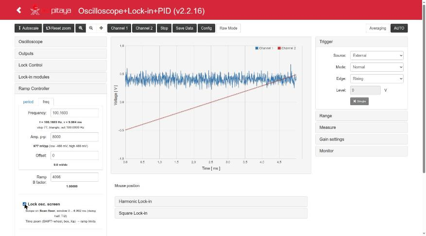

**Turning it on** (`rampLockScreenOn()`, l. 3902):

- the scope trigger becomes *Ext Trig* = **Scan floor**, *Source* = **External**, *Mode* = **Normal** (as when
  choosing an Ext Trig);
- the time window becomes 0 … T/2, so t = 0 is the scan floor;
- a *Capture Lock* in progress ends first;
- the text below the checkbox shows the window and "Time zoom (SHIFT+wheel, box, X±) → ramp limits".

**Zoom while it is on** (`rampLockScreenFromX()`, l. 3937, and `rampZoomToLims()`, l. 3612):

| Action on the plot | Effect |
|---|---|
| **SHIFT + wheel**, a **box selection**, the **X− / X+** buttons of *Range* (time zoom) | New `ramp_low_lim` / `ramp_hig_lim`: the values that the ramp has at the two ends of the window zoomed, on the straight line of the rise, $v(t) = \mathrm{low} + \mathrm{amp}\cdot t/(T/2)$, also outside 0 … T/2 (zoom out, pan). The **frequency of the whole period is kept** (step recomputed with the new N) and the window goes back to the new T/2, so the zone chosen fills the screen. |
| The Y part of a box selection | Zooms Y (only in the page), as usual. |
| A box over the **whole width** of the view (within 2 % at each end) | No time zoom: the ramp does not change, only Y is zoomed (`rampZoomIsView()`, l. 3637). |
| **Wheel without keys** | Y only (normally it zooms both axes); **ALT + wheel**: Y only, as before. The registers do not change. |
| **Reset zoom** | Gives the window of Lock osc. screen again. |

The result is limited to −8192 … 8191 with at least 1 count of amplitude.

Measured on the board (v2.2.16, triangle ±4000 at 100 Hz, Channel 2 = Ramp A; each row starts from the result of the
previous one; the model is $v(t)$ above):

| Action | Result |
|---|---|
| Lock osc. screen on, *Scan direction* 0 and 1 | window 0 … 4.992 ms in both cases, Ramp A rises from −0.488 V |
| Box 0.968 … 2.419 ms | low / hig −2448 / −124 (model −2448.2 / −123.6), f 99.975 Hz |
| SHIFT + wheel out | amplitude ×1.500, f 100.161 Hz |
| SHIFT + wheel in | −2794 / −470 |
| X+ / X− | f 99.648 Hz / 100.140 Hz |

**The window follows the ramp**: any change of step or limits (either tab, the wheel on the fields, another client,
a config load) sets the window again (only when the ramp changed; `rampLockScreenSync()`, l. 3867). The trace is
cleared only if the window really changes: a zoom that keeps the frequency keeps the acquisition in progress. Windows
longer than 68.7 s are clamped to the longest memory (shown in the text).

**Slow scans / continuous update** (acquisition windows ≥ 1.5 s, the regime of `src/worker.c` in which the trace is
published while it is acquired, see [Slow scans](#slow-scans)):

- armed in Normal on the scan floor, the trace always starts at the floor and **grows to the right**; it reaches the
  top at T/2, stays still for the other half period and starts again from the floor;
- the time zoom uses the model of the ramp, not the samples, so it works with an incomplete trace; after a zoom the
  acquisition in progress (old limits) ends and the next one starts at the next floor of the new ramp.

Example (v2.2.16, 0.2 Hz triangle ±4000, T = 5 s, step 39062): window 0 … 2.5 s with continuous update.

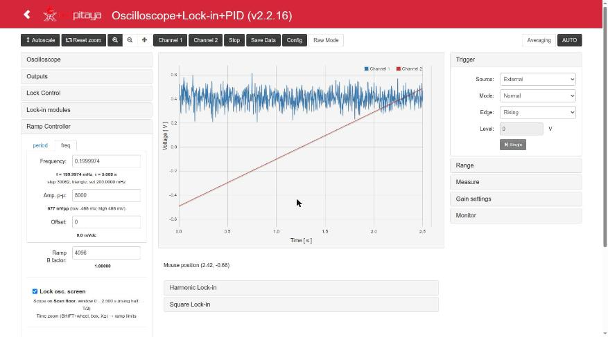

**Turning it off** (`rampLockScreenOff()`, l. 3924):

- unchecking it: the trigger (External / Normal / Scan floor) and the time window **stay as they are**; only the
  normal time zoom of the plot comes back (SHIFT + wheel zooms the view again, without touching the ramp);
- choosing another *Source*, *Ext Trig* or *Mode* in the page (also *Mode* = Single), pressing **AUTO**
  (`serverAutoScale()`, l. 6750), or pressing **Single** (`singleUpdate()`, l. 6272) also turns it off, with the same
  rule (trigger and window kept, the choice of the user applied); seen on the board: Mode Single unchecks it;
- it is **not saved** in the configs (it is a state of the page: after a reload it is off).

**With Capture Lock** ([Lock Control](#lock-control)): during a capture *Lock osc. screen* is suspended (the
capture uses its own trigger and window; the wheel zoom is only in the page, as for any capture) and when the
capture ends it comes back with its window; ending the capture with **Single** turns it off (above).

The panel before v2.2.16 (no tabs) is visible on the left of the [layout screenshot](#layout-of-the-page) (v2.2.6:
±5000 counts, period 400 → τ = 64.16 ms, f = 15.59 Hz).

### PIDs modules

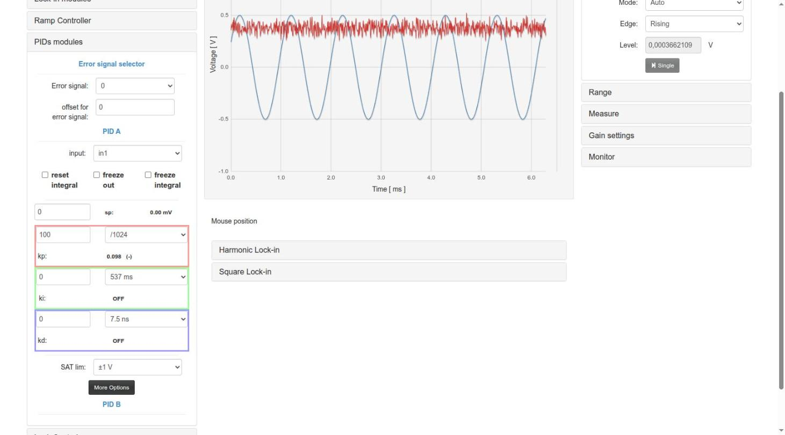

- **Error signal selector**: *Error signal* (0, in1, Xo, F1o, F3o, sqXo, sqYo, sqFo) and its *offset*.
- **PID A / PID B**: *input* (error, signal_i, in1, in2, in1−in2; with *More Options* also Xo, Yo, F1o..F3o,
  sqXo..sqFo, Ramp A, the references, aux_A/B), *reset integral*, *freeze out*, *freeze integral*, and the gains
  *kp*, *ki*, *kd* with the effective value below (kp as a factor, ki and kd as τ and f, and the sign of the
  feedback).
- **More Options** shows the set point *sp* (with mV below), the scale of kp (/1 .. /4096), ki (8 ns .. 9 s; option 4
  is "65 us" since v2.2.6) and kd (7.5 ns .. 491.5 µs), and *SAT lim* (saturation of the integral term, ±122 µV .. ±1 V).

In the screenshot kp = 100 with /1024 gives 0.098.

### Lock Control

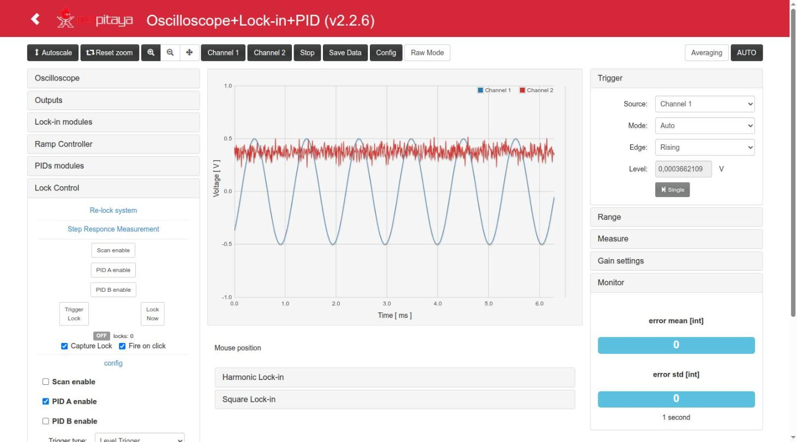

From top to bottom:

- **Re-lock system** and **Step Responce Measurement** (open them with their titles, see below).
- **Scan enable / PID A enable / PID B enable**: buttons with the **effective** state of the ramp and the PIDs
  (dark = on). When nothing is locked a click toggles the manual enable; while LOCKED a click releases the lock
  keeping the other enables.
- **Trigger Lock**: arms the lock; it closes when the trigger of the *config* section happens. **Lock Now**: locks
  at once. Both stay pressed while requested; a second click releases the lock.
- **time / level / time+level** (the three small colored buttons between Trigger Lock and Lock Now; since
  v2.2.13): a shortcut for *Trigger type* + *Choose from graph* + *Fire on click*. Click one (it stays filled while
  it waits, the cursor over the plot is a crosshair and a short note covers the state label and the checkboxes
  below), then click on the plot: the trigger type is set, the time
  and / or level are taken from the click, and *Trigger Lock* fires at once (with *Capture Lock* if checked, even if
  *Fire on click* is unchecked). An active lock is kept until that click, then released and armed again. Esc or a
  second click on the same button cancels.
- **State label**: OFF / ARMED / LOCKED and the number of locks since the FPGA was loaded.
- **Capture Lock** (on by default): every lock request from the page captures the closing of the loop in the scope
  and freezes the trace. **Fire on click** (on by default): with *Choose from graph*, a click on the plot sets the
  trigger value and fires *Trigger Lock*. Design: [`lock_capture.md`](../lock_in+pid/doc/lock_capture.md).
- **config**:

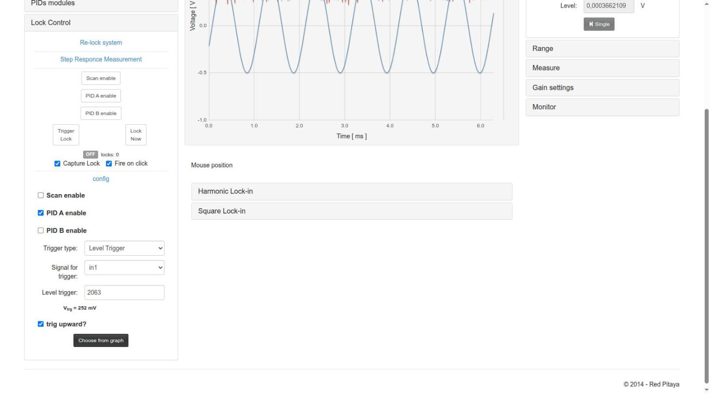

  - *Scan enable*, *PID A enable*, *PID B enable*: what is on **while LOCKED** (usually: scan off, PID A on).
  - *Trigger type*: OFF (only Lock Now), Time trigger, Level Trigger, Level+time Trigger.
  - *Time trigger*: delay after the scan floor, in ticks of 8 ns or with units (`16.58 ms`, `20 s`); shown as T
    below. Up to 4294967295 = 34.36 s (32 bits since v2.2.6).
  - *Signal for trigger* (error, Xo, Yo, F1o..F3o, sqXo..sqFo, signal_i, Ramp A, aux_A, in1, in2, in1−in2, PID A
    out), *Level trigger* (counts or `V`/`mV`, shown in mV below) and *trig upward?*: for the level trigger.
  - **Choose from graph**: the next click on the plot sets the time (Time trigger) or the level (Level trigger). A
    second click on the button (*Cancel*) or Esc cancels it. A red warning appears if the scope is not in
    Normal/Single + External + Scan floor (the only setup where t = 0 of the plot is the scan floor).

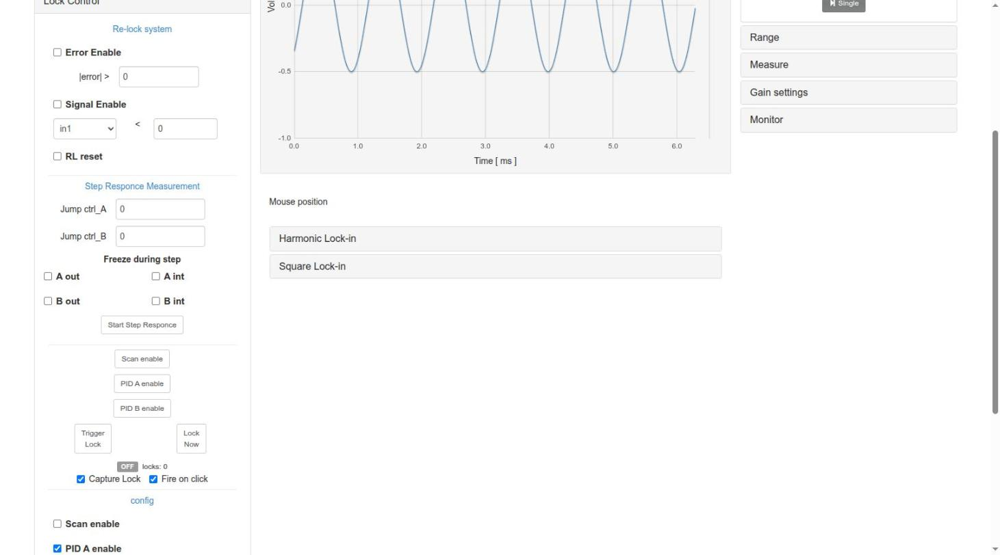

- Re-lock: *Error Enable* with `|error| >` threshold, *Signal Enable* with a signal `<` threshold, *RL reset*.
- Step response: *Jump ctrl_A*, *Jump ctrl_B*, *Freeze during step* (A/B out, A/B int), *Start Step Responce*.
- Neither was tested on 2.0 ([App.md](App.md#re-lock-and-step-response)).

How the lock control works inside: [`lock_control.md`](../lock_in+pid/doc/lock_control.md) and
[Structure.md](Structure.md#lock-control).

### Right panels and displays

- **Trigger**: *Source* (Channel 1, Channel 2, External), *Mode* (Auto, Normal, Single), *Edge*, *Level* (in V, or in
  ADC counts in Raw Mode, −8192 … 8191, since v2.2.14), and the *Single* button. External uses the *Ext Trig* of the Oscilloscope panel.
  **Auto** (since v2.2.11) waits for the trigger as *Normal* does (the *Level* of the source channel, or the
  *Ext Trig* with Source = External) and forces an acquisition only when no trigger comes within a time limit:
  the largest of 0.25 s, 1.1 × the window + 50 ms and, when the period of the Ext Trig is known (Scan floor /
  Scan ceil with the scan running, harmonic mod. / Square mod.), 1.1 × that period + 50 ms; at most 80 s. So with Ext Trig = Scan
  floor, t = 0 is the scan floor in Auto too (a 30 s scan in a 0…29.4 s window waits up to 33 s and every scan is
  acquired from its floor), and without a trigger (scan stopped or locked with the ramp off, Ext Trig None, a level
  the signal never crosses) the traces keep coming: every 0.25 s plus the acquisition for short windows. As before,
  an Auto acquisition starts at the trigger (no negative times). Up to v2.2.10 Auto triggered at once, at any phase
  of the scan (Scan floor seemed to trigger at the ceiling). The *Level* field and line work in Auto too.
- **Range**: buttons for the X and Y scales and offsets (the X+ button goes up to 68.72 s since v2.2.7; it
  stopped at 10 s before).
- **Measure**: min, max, amplitude, average, frequency and period of each channel.

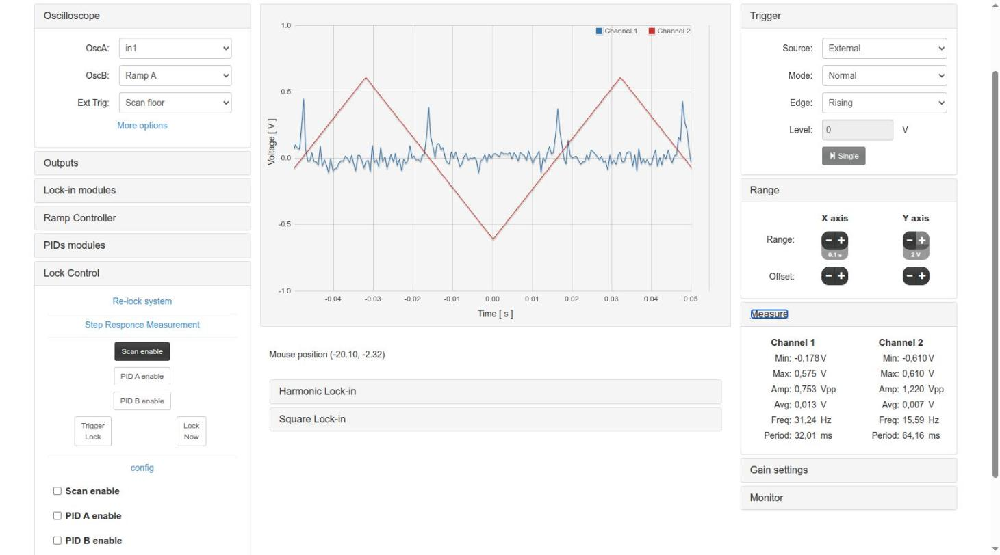

- **Gain settings**: probe attenuation and LV/HV jumper of each input (scale of the display).
- **Monitor**: mean and standard deviation of the error over ~1 s, in counts.
- **Harmonic Lock-in** / **Square Lock-in** (below the plot): X, Y, R, φ (and F1, F2, F3) in volts, computed from
  the 28-bit demodulated values (before the *Amplification*):

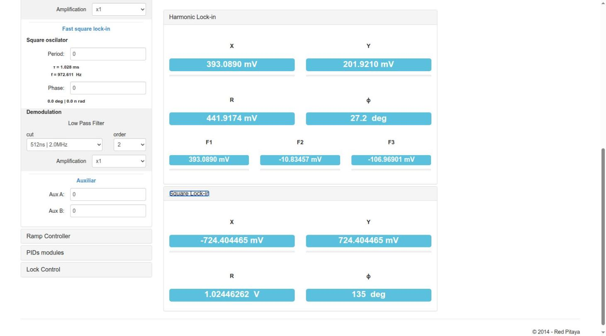

Range 6 of the time axis (68.7 s):

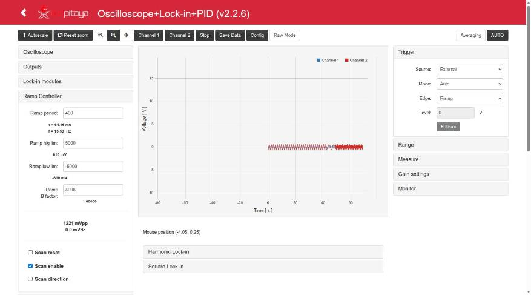

In the screenshot: *Ramp period* 124999 (τ = 20.00 s), OscA in1 / OscB ctrl_A, Ext Trig = None, Trigger Channel 1
/ Auto, window 0 … 68.72 s: the trace is complete from 0.067 s to 68.65 s (1024 points), 3½ triangles of ctrl_A
with the peaks of in1. See also [Slow scans](#slow-scans).

### Slow scans

With windows of 1.5 s or more (e.g. a 30 s ramp) the scope reads its memory while the FPGA is still writing it.
Since v2.2.9 (port of lock_in+pid_harmonic v2.3.23, see the CHANGELOG):

- **Reset zoom** on a scan of period T ≥ 1.5 s (Ext Trig = Scan floor / Scan ceil / harmonic mod. / Square mod.)
  sets the window to 0 … 0.98 × T (at least 50 ms before the next trigger), so that the scope is armed again in
  time and every scan is acquired. Shorter periods keep one whole period. The rising half (second click with Scan
  floor, v2.2.16) is 0 … T/2: it already ends half a period before the next floor, so no 0.98.
- **Lock osc. screen** (v2.2.16) uses 0 … T/2 and keeps it when the ramp changes; its time zoom works on an incomplete
  trace ([Lock osc. screen](#lock-osc-screen)).
- The trace is drawn **while it is acquired**, only with valid points of the current acquisition (it starts and
  ends at the valid ones, never mixed with an older lap of the memory, and the previous trace is not left to the
  right). In Normal mode the **whole trace is only seen near the end of each scan**: between the end of the
  window (0.98 × T) and the next scan floor. In Auto mode the same happens for every acquisition (the 68.7 s
  screenshot above shows a whole acquisition just before the next one starts).
- **Capture Lock** works with slow scans (Time trigger, Level trigger and Lock Now): the lock request is held until
  the scope has loaded its **history before the lock** (the part of the window before t = 0; banner "loading the
  scope history before the lock (x s)"), then the lock is applied and the capture is drawn as it is acquired.
  Lock Now on a slow window therefore locks after that history, on purpose.
- (FPGA) A time trigger armed after the ramp was stopped (e.g. right after releasing a lock) waits for the next
  scan floor instead of firing in the middle of the scan.

## Typing values with units

The **Time trigger** and **Level trigger** fields of *Lock Control → config* are text fields that accept a number
with a unit (v2.2.6, from lock_in+pid_harmonic v2.3.16; `parseTrigTime()`, `parseTrigLevel()` in `index.html`):

| Field | Without unit | Units | Range | Examples (tested on the board, v2.2.6) |
|---|---|---|---|---|
| Time trigger | ticks of 8 ns | `s`, `ms`, `us` (`µs`), `ns`, `tick(s)` | 0 .. 4294967295 (34.36 s); larger values are clamped | `16.58 ms` → 2072500, `20 s` → 2500000000, `40 s` → 4294967295 |
| Level trigger | counts | `V`, `mV`, `count(s)` | −8192 .. 8191 | `0.1 V` → 819, `120 mV` → 983, `5085` → 5085 |

An empty or invalid text (`abc`) is not sent: a red hint appears and the last value comes back. Values above $2^{24}$
ticks (134 ms) go through the float parameters of the controller and are rounded to the float32 grid (≤ 1 µs).
(`parseTrigTime()` l. 2475, `parseTrigLevel()` l. 2482, `input_unit_parsers` l. 2489-2491 of `index.html`.)

Since v2.2.16 **Ramp period** (tab *period* of the Ramp Controller) is also a text field with units: steps, or the
whole period of the ramp in `s`, `seg`, `ms`, `us` (`rampStepParseField()` in `input_unit_parsers`), sent with Enter or
when leaving the field and rewritten in steps ([Tabs period and freq](#tabs-period-and-freq)). The fields of the
*freq* tab accept units too (*Frequency* in Hz / kHz / mHz…, *Amp. p-p* and *Offset* in counts or `mV` / `V`).

The other number fields are `<input type="number">`: the browser does not give a text with letters to the page
(`.val()` is empty), so the unit conversions that the JavaScript has for them can not be reached from the page ("1 ms"
in Period stays 1; `reportes/lock-in_pid.md`, 2.2.5; the same was found for *Ramp period* in `lock_in+pid_plus`
2.2.0-rc2):

| Field | Conversion in the code (`index.html` v2.2.16) | Usable from the page |
|---|---|---|
| Ramp hig / low lim | `V`, `mV` → counts (`lock_ramp_step_update()`, l. 2017-2035) | no (use *Amp. p-p* / *Offset* of the *freq* tab) |
| PID A / B sp | `V`, `mV` → counts (l. 2138-2146, 2245-2253) | no |
| Period of the harmonic oscillator | `s`, `seg`, `ms`, `us` → `gen_mod_hp` (`lock_modulation_update()`, l. 2357-2367; clamped to 819100, more than the 16383 of the field) | no |
| Phase of the harmonic oscillator | `g` / `deg` / `°`, `rad`, `pi` → counts (l. 2345-2355; clamped to 2520, one more than the 2519 of the register) | no |
| Period of the square oscillator | `s`, `seg`, `ms`, `us`, `ns` → `gen_mod_sqp` (l. 2369-2381; clamped to 819100, the register is 32 bits; `ns` gives value / 8, the other units period / 16 ns − 1: unreachable, not consistent) | no |

## Procedures

These procedures follow the concepts of the published documentation and the tests of `reportes/lock-in_pid.md`.
The example values are those used on the test bench: a system with a resonance (a peak) whose control input is
OUT1 and whose response is measured on IN1.

**A confirmar:** a real lock with this App (closed loop on a system) was not validated on the current bench;
the steps 3 and 4 below were checked only as states, registers and captures of the page, not as a stable lock.

### 1. Scan and see the response of the system

1. **Outputs**: Out1 = `ctrl_A`.
2. **Ramp Controller**: limits ±5000 (±610 mV), period 400 (64.16 ms), *Scan enable* checked.
3. **Lock Control**: *Scan enable* button on, *PID A enable* off.
4. **Oscilloscope**: OscA = `in1`, OscB = `Ramp A` (or `ctrl_A`); Ext Trig = *Scan floor*.
5. **Trigger**: Source *External*, Mode *Normal* (picking an Ext Trig already sets them, v2.2.10). Press
   **Reset zoom**: the window goes from 0 to one period of the ramp (0 … 64.16 ms) and t = 0 is the scan floor.
   The preset `in1|ctrl` sets OscA = in1, OscB = ctrl_A in one click.

The response of the system appears at the same position in every sweep (in the screenshots of the
[layout](#layout-of-the-page) and of the [Oscilloscope](#oscilloscope), two peaks per period, on the way up and down
of the triangle).

Alternatives since v2.2.16: in step 2 use the **freq** tab (e.g. Frequency `15.59 Hz`, Amp. p-p 10000, Offset 0), or
type `64.16 ms` in *Ramp period* (gives step 400); and instead of step 5 check **Lock osc. screen**, which sets the
trigger and the window of the rising half of the triangle (0 … 32.08 ms: each peak of the response appears once) in
one click. Then a **box selection** (or SHIFT + wheel) around the peak narrows the scan to that zone at the same
frequency: the peak gets wider on the screen, which is a quick way to find the limits of a scan for the lock
([Lock osc. screen](#lock-osc-screen)). Without Lock osc. screen, a second click of *Reset zoom* also shows the rising
half ([Reset zoom](#reset-zoom-whole-period--rising-half)).

### 2. Get an error signal

The PID needs a signal that crosses zero at the point where the system has to stay:

- **With a lock-in** (derivative of the response): modulate the system with a reference (this App does **not** add
  it to OUT1: use e.g. Out2 = `cos_ref` or `sq_ref` summed to the control input of the system outside the board,
  or the digital modulation on DIO7_N), set **Lock-in input** = `in1`, choose the modulation Period, a filter
  well below the modulation frequency, and look at `Xo`/`Yo` (harmonic) or `sqXo`/`sqYo` (square) during the scan.
  Change the *Phase* (or choose X / Y) until one component is a clean dispersive curve with a zero crossing at the
  peak. Then select it as *Error signal* (`Xo`, `F1o`, `F3o`, `sqXo`, `sqYo`, `sqFo`) or directly as PID input
  (`Yo`, `F2o` are only available as PID input).
- **Without modulation** (side of fringe): *Error signal* = `in1` with *offset* = the level of the flank where the
  system has to stay (or PID input `in1` with set point `sp`).

### 3. Close the lock

1. **PID A**: input = error (or the chosen signal), kp and ki with the sign that gives negative feedback around the
   zero crossing (try the other sign if the lock runs away).
2. **Lock Control → config**: while locked, *PID A enable* on and *Scan enable* off.
3. Choose the trigger:
   - **Time trigger**: press *Choose from graph* and click on the point of the scan where the lock must close. With
     *Fire on click* on, the click also fires *Trigger Lock*.
   - Shortcut: press the small **time** (or **level**, **time+level**) button between *Trigger Lock* and
     *Lock Now* and click on the plot: type, value and *Trigger Lock* in one go (steps 3 and 4).
   - **Level trigger**: Signal for trigger = error (or in1), Level = the value just before the crossing, *trig
     upward?* according to the slope. *Choose from graph* takes the level from the click.
   - **Lock Now**: locks immediately wherever the ramp is.
4. Press **Trigger Lock**. The state goes OFF → ARMED → LOCKED in the next sweep; with *Capture Lock* the scope shows
   the closing of the loop (t = 0 is the lock) and keeps it frozen:

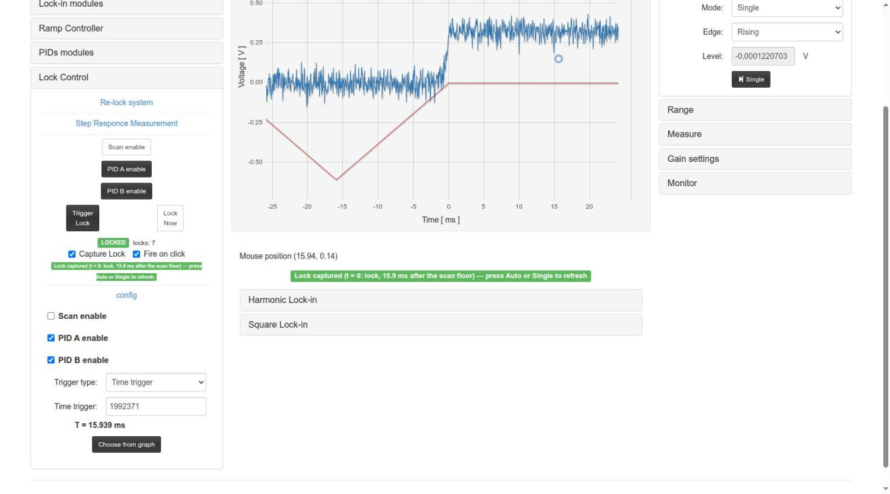

With the level trigger the lock is placed at 30 % of the window:

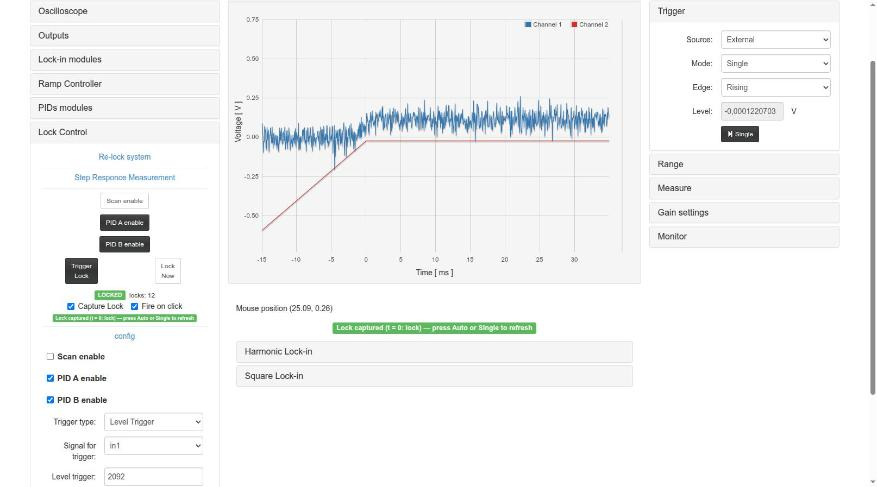

While ARMED (here with a time trigger of 34 s) the page waits for the capture:

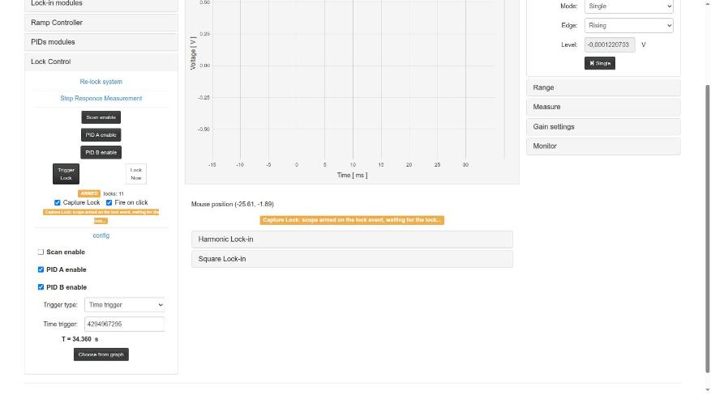

Choose from graph, Trigger Lock, Lock Now and release (GIF):

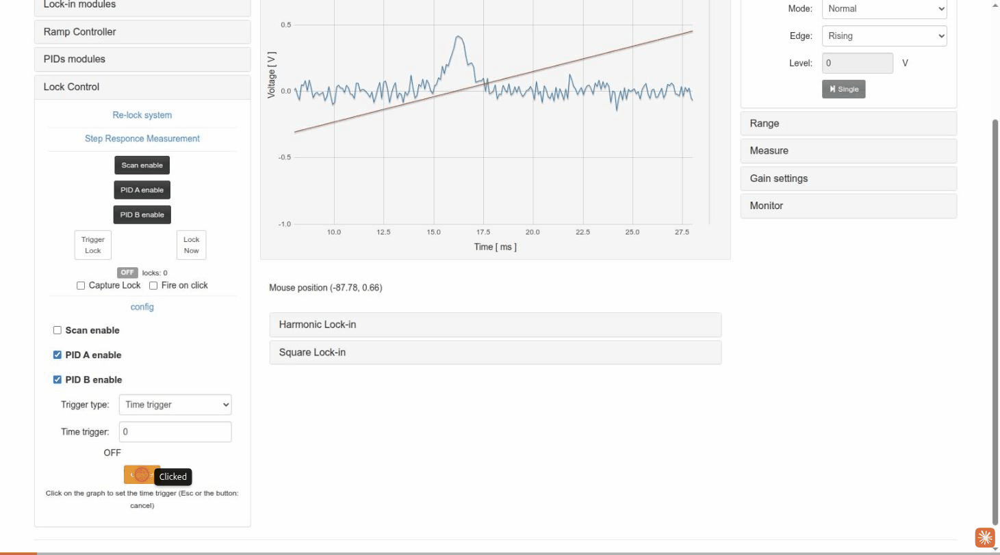

Capture Lock and Fire on click on a frozen capture (GIF, v2.2.10). It shows the **page sequence only**: the PID
gains were 0, so "LOCKED" just stops the ramp and holds ctrl_A where the trigger happened (in1 stays at the level of
that point); it is not a lock of the system. Frames: scan (OFF, Time trigger 0); *Choose from graph*; click on the
peak at 16.31 ms → LOCKED, capture frozen, Time trigger 2039088 (T = 16.313 ms, "16.3 ms after the scan floor");
*Choose from graph* on the capture and a click at t = −2.95 ms (**Fire on click**) → locks 2, Time trigger 1669799
(T = 13.358 ms); **AUTO** ends the capture; a second click on *Trigger Lock* releases, Reset zoom shows the scan
again:

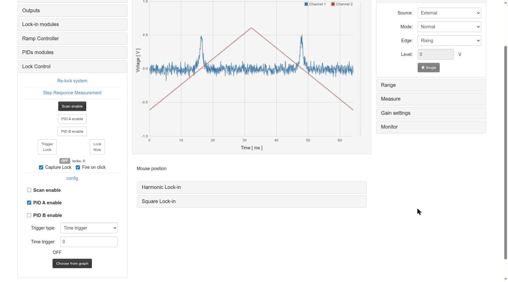

The frozen capture ends (and the scope settings saved before the capture are restored) with trigger mode
Auto/Normal, *Single*, **AUTO**, a change of source or Ext Trig, or unchecking *Capture Lock*. *Autoscale* keeps it.

### 4. Check the lock and release it

1. Set the trigger Mode to **Auto**: the ramp has stopped; OscA = `ctrl_A`, OscB = `error` (the error should stay
   around 0), or OscA = `in1` (the signal should stay at the lock point).
2. The **Monitor** panel shows the mean (≈ 0 when locked) and the std of the error.
3. **Release**: a second click on *Trigger Lock* (or *Lock Now*), or a click on *Scan enable* (restarts the scan
   with the PIDs as they were). The page sends no POST while the lock is held (verified: 0 POST in 30 s LOCKED).

A lock can also be closed and checked without the web page, with `py/lock_from_registers.py` on the board (see
[Remote.md](Remote.md)); the page follows the state (OFF / ARMED / LOCKED) without sending anything.

## Saving and loading configurations

**Config** opens the configuration dialog (the same as in lock_in+pid_harmonic):

- *Save in browser* stores all the parameters (and the Capture Lock / Fire on click preferences) under the *Config
  Name* in the browser (`localStorage`, key `lockConfig_lock_in+pid`). *Save as file* downloads a JSON.
- The list shows the saved configs with *del*, *download* and *load*. *Load file* adds a JSON file to the list.
- **Don't turn on PIDs and Ramp on config loading**: **unchecked by default** (since v2.2.11; up to 2.2.10 it was
  checked). Unchecked, *load* (also of a *Load file*) sets the ramp (*Scan enable* and the Lock Control ramp
  enable) and the PIDs as they are in the config: a config saved while scanning loads scanning. Checked, a loaded
  config never turns them on (useful when the outputs are connected to an experiment). The same option applies to
  the restore of the last config / tab state after a start / *Restart*. A lock request (*Lock Now*, *Trigger Lock*) is never
  loaded. The option is not saved: every page load starts with it unchecked.
- Configs are per browser, not stored on the board. Configs of lock_in+pid_harmonic are not shown (own key since
  v0.2.4).
- **Load last config on init** (since v2.2.12): **checked by default**; the choice is kept in the browser
  (`localStorage`, key of this App). The page saves the current settings automatically every ~2 s (the *last
  config*, also in `localStorage`). Checked, each time the page starts the App (main menu, new tab, F5) it restores
  the last config; unchecked, the App starts with its defaults. The ramp / PIDs of the restored config follow the
  option above; a lock request is never restored.
- **Load last config** / **Reset to defaults** (since v2.2.12): close the dialog and restart the App (the page reloads,
  the FPGA is reloaded: outputs and lock are reset) with the last config / with the default parameters of the App (as
  a fresh start: lock open, ramp stopped, PID gains 0), whatever the checkbox says. After *Reset to defaults* (or an
  open with the box unchecked) the last config is kept until a parameter is changed, so *Load last config* brings it
  back.
- **Time window** (v2.2.6): *load* applies the window of the config in the units it was saved with (a config saved
  in ms loaded with the scope in µs keeps its window in ms; up to v2.2.5 it was applied in the units of the
  server). The scale values derived by the server and the read-only values are not sent.

- *Lock osc. screen* and the active tab of the Ramp Controller are not saved in the configs (v2.2.16). A load changes
  the ramp, so with *Lock osc. screen* on the window follows it.

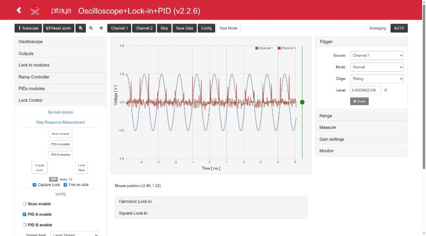

## Saving data

*Save Data* gives the data of the plot as Python/Numpy vectors, Matlab/Octave vectors or CSV (save as a file, copy
or show).

## Several clients and Restart

Only one browser tab should control the board. When another client (another tab, the main menu, another App) takes
the board, the page stops polling and shows a dialog; *Restart* restarts the App and restores the state of the tab (with *Load last config on init* checked or not):

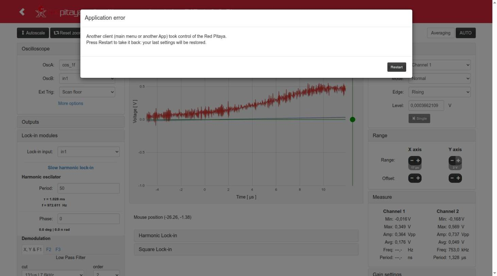

If the App was stopped from outside (e.g. `bazaar?stop=`), the open page starts it again and restores its state.
On Ecosystem 2.0 the page enters a "cautious mode" when the board answers slowly, and waits until it answers fast
again.

## Known limitations of the interface

- **Slow out1 / Slow out2** have no effect; the **R|Phase Mode** button is disabled.
- *Time trigger* values above $2^{24}$ ticks (134 ms) set from the page are rounded to the float32 grid (≤ 1 µs).
- *Ramp hig lim* / *Ramp low lim* (tab *period*) do not accept `mV` / `V`: they are `<input type="number">` fields
  ([Typing values with units](#typing-values-with-units)); use *Amp. p-p* / *Offset* of the *freq* tab.
- The mouse wheel over *Ramp period* does not move the step above $2^{24}$ (16777216 steps; with N = 16000 a period of
  ≈ 2147 s): the parameter travels as a float32, and ±1 rounds back to the same value (granularity 2 … 128 there). At
  the maximum 2147483520, wheel −1 sends 2147483519 and 2147483520 comes back (seen on `lock_in+pid_plus` 2.2.0-rc2,
  same code). Typing a value or a period works. (The wheel of the *freq* tab already moves to the next float32 step.)
- After a **reload of the page with a slow scan running** (windows ≥ 1.5 s, continuous update), the X axis may follow
  the trace while it grows instead of staying on the window; *Reset zoom* fixes it (seen on `lock_in+pid_plus`
  2.2.0-rc2, same code; not checked on this App).
- `loadParams()` keeps the window of the plot in the parameters only when its minimum is not 0
  (`if(options.xaxes[0].min && options.xaxes[0].max)`, `index.html` l. 5408): with a window that starts at t = 0 the
  parameters take the `xmin` / `xmax` of the server instead of those of the plot. Since v2.2.16 the *Force X* is filtered
  and a window of the page that the server did not take is sent again
  ([Structure.md](Structure.md#time-window-of-the-plot-and-force-x)), but the rule of `loadParams()` is unchanged
  (pending for devAgent).
- A `POST /data` that gets no answer is retried twice (`post_chunk_retries`, `index.html` l. 133, 2 s each); if the
  retries also time out (e.g. a real hang of nginx during the test of v2.2.16) the page shows "Error while sending data
  (E3)".
- Fixed in v2.2.7 (seen in v2.2.6): Time / Level written from Python (`lock_from_registers.py`) did not appear in
  the page and were rewritten at the next change of a lock parameter ([Structure.md](Structure.md#lock-control));
  AUTO with the lock closed (only noise) chose a window of 0…139 ns (minimum 1 µs now); the τ/f text of
  *Ramp period* was not refreshed with the wheel; the X+ button of *Range* stopped at 10 s.
- Each change made in the page is a `POST /data`, and on Ecosystem 2.0 each one leaves an open connection in the
  nginx of the board ([Remote.md](Remote.md#the-post-data-interface-of-the-ecosystem)).

These items are listed for devAgent in `docAgent.md`.
